<div align="center">


# Sound Blaster Command for Linux

**A native control panel for the Creative Sound Blaster ZxR on Linux.**<br>
Creative's SBX effects and profiles, the equaliser, speaker setup and microphone effects, plus fixes for the card's Linux driver.

[](LICENSE)


</div>

Creative only makes Sound Blaster Command for Windows. On Linux the ZxR works, but its DSP, equaliser,
speaker setup and microphone effects are hidden behind dozens of raw ALSA controls, and a few of the
defaults are actively bad (more on that [below](#what-it-fixes-on-linux)). This app puts all of it in
one window and works around those defaults.

> **Not affiliated with Creative Technology.** "Sound Blaster", "SBX", "CrystalVoice", "Crystalizer" and
> "Scout Mode" are Creative's trademarks; they're used here only to name the features of their hardware.

---

## Contents

- [Highlights](#highlights)
- [Tour](#tour)
- [What it fixes on Linux](#what-it-fixes-on-linux)
- [Supported cards and systems](#supported-cards-and-systems)
- [Install](#install)
- [Using it](#using-it)
- [Privacy and safety](#privacy-and-safety)
- [How it works](#how-it-works)
- [Development](#development)
- [License](#license)

## Highlights

- Creative's SBX effects: Surround, Crystalizer, Bass, Smart Volume and Dialog+, each with an on/off switch and a
  level knob.
- All ten of Creative's profiles (Gaming, FPS, Racing, RPG, Strategy, Cinema, Night, Music, Concert, Stadium) with
  the same values as the Windows app. You can add your own and import or export them.
- A 10-band equaliser you adjust by dragging, with Creative's ten presets taken from the driver.
- A room view of your speakers with live level meters. Click a speaker to play a test sound on it.
- What's playing (title, artist, cover art) and the path its sound takes: the app's format, any resampling or
  downmixing by PipeWire, the card's processing, and the speakers it reaches.
- SBX or Pure mode (Pure turns off the SBX effects; your equaliser stays on), and 5.1 or 2.1 speaker layouts.
- Stereo can play on the fronts only, the fronts and rears, or every speaker. 5.1 films and games play as mixed.
- Game, Movie & TV and Music modes, picked automatically when Steam, a film or Spotify starts if you want.
  Settings are remembered per game and app, and the Music EQ can follow each song's genre.
- A tray icon for the common switches, so you don't need to open the window.
- CrystalVoice microphone effects, a mixer with meters, speaker boost, speaker setup and headphone gain.

## Tour

<table>
<tr>
<td width="50%">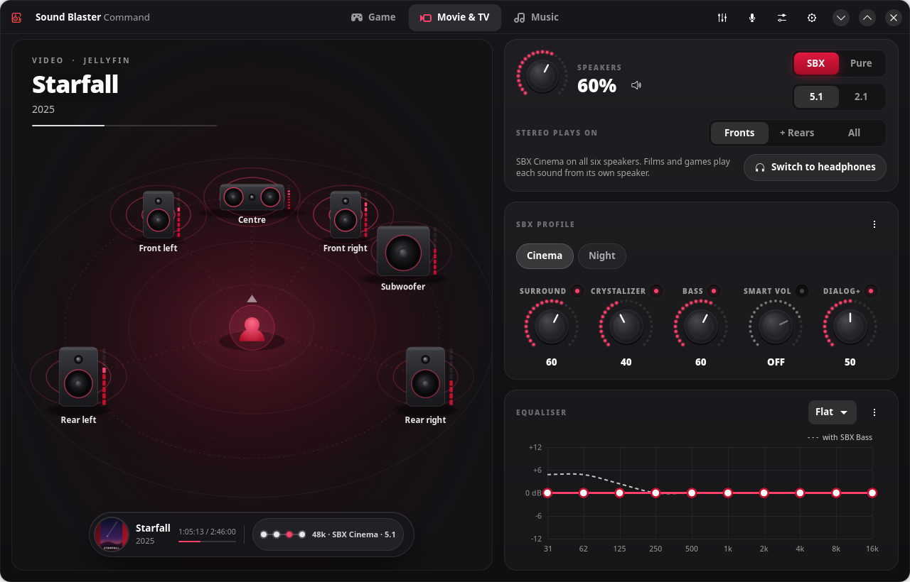<br>
<b>Movie & TV.</b> A 5.1 film from Jellyfin: every speaker lit, each with its own sound. The capsule shows
the poster, progress and a compact signal path (<code>48k · SBX Cinema · 5.1</code>).</td>
<td width="50%">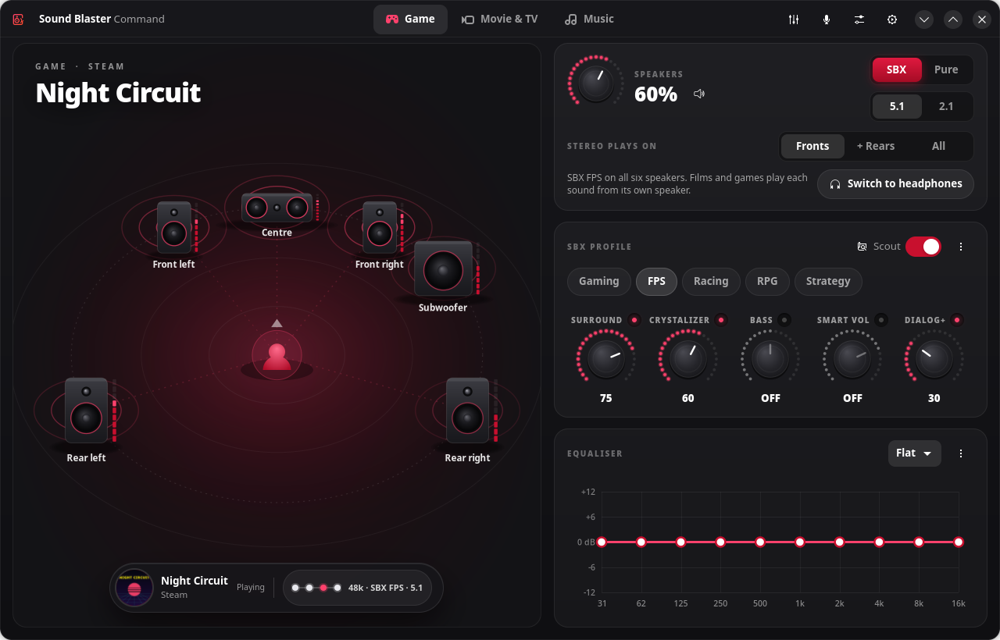<br>
<b>Game.</b> The game's name and artwork come from Steam's own files. The FPS profile is selected, and
Scout Mode (footsteps and quiet sounds sooner) appears only for games.</td>
</tr>
<tr>
<td>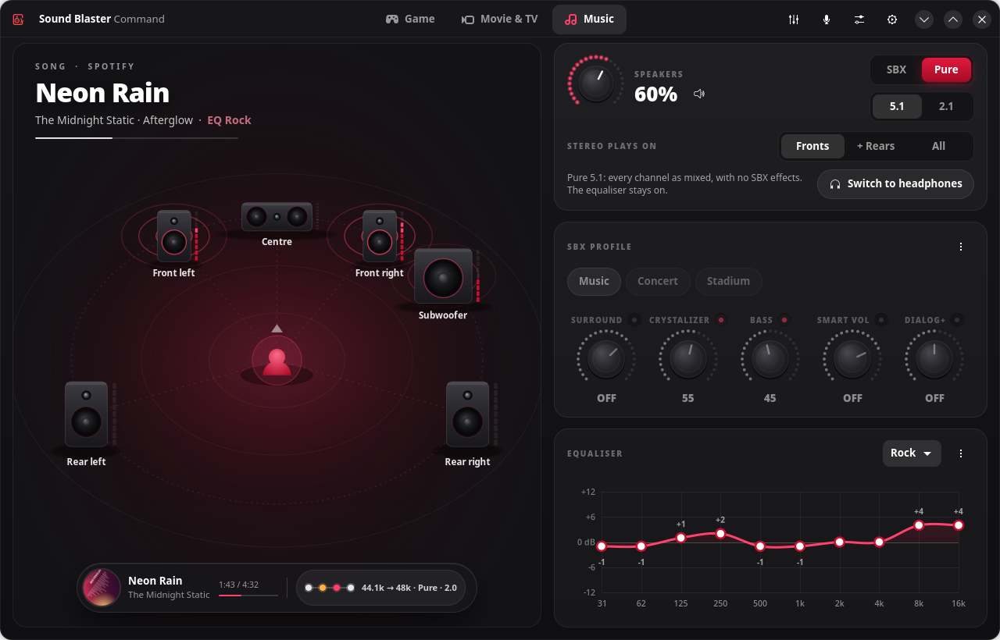<br>
<b>Pure.</b> The SBX effects are off and their knobs grey out. The equaliser stays on, as in Creative's
own app, where SBX and the equaliser are separate switches.</td>
<td>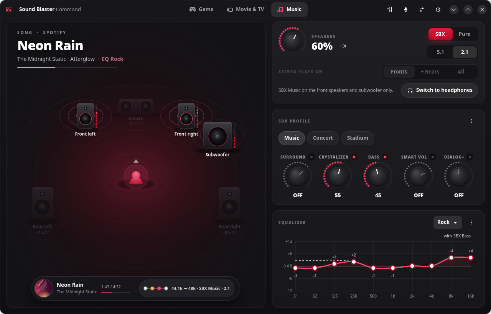<br>
<b>2.1.</b> Everything on the front speakers and subwoofer. The centre and rears dim and say so.</td>
</tr>
<tr>
<td>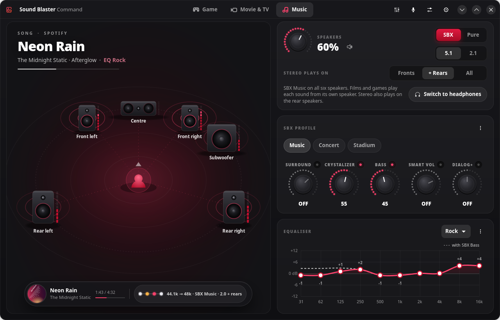<br>
<b>Stereo plays on + Rears.</b> A stereo song also plays on the rear speakers, like Creative's Windows app.
Pick <b>All</b> to add the centre too. The room and the signal path show exactly where it goes.</td>
<td>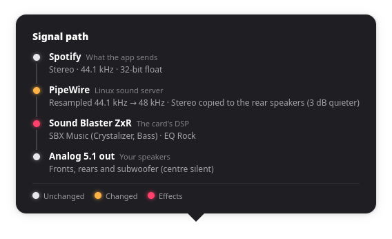<br>
<b>Signal path, stereo on the rears.</b> The rears get a copy of the fronts, 3 dB quieter, so the sound
fills the room without pulling the stereo image backwards.</td>
</tr>
<tr>
<td>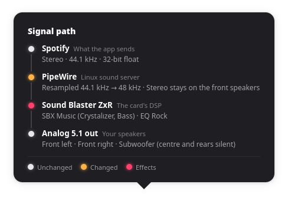<br>
<b>Signal path, stereo song.</b> Spotify sends 44.1 kHz stereo; PipeWire resamples it to the card's 48 kHz
(amber: changed); SBX and the EQ shape it (pink: effects); it plays on the fronts and subwoofer.</td>
<td>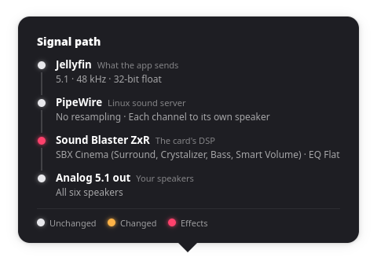<br>
<b>Signal path, 5.1 film.</b> 48 kHz 5.1 straight through, no resampling, each channel to its own speaker.</td>
</tr>
<tr>
<td>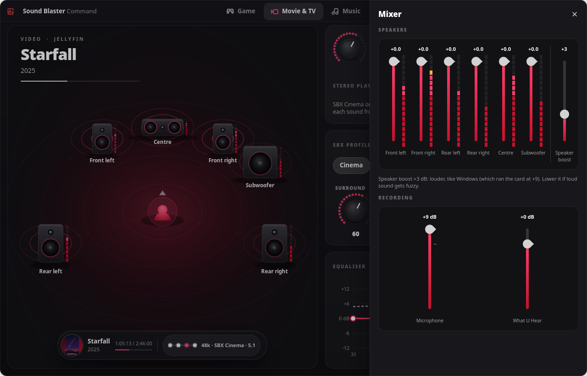<br>
<b>Mixer.</b> A fader and live LED meter per speaker, <b>Speaker boost</b> (0 to +9 dB, like Windows), and
the microphone and What U Hear recording levels.</td>
<td>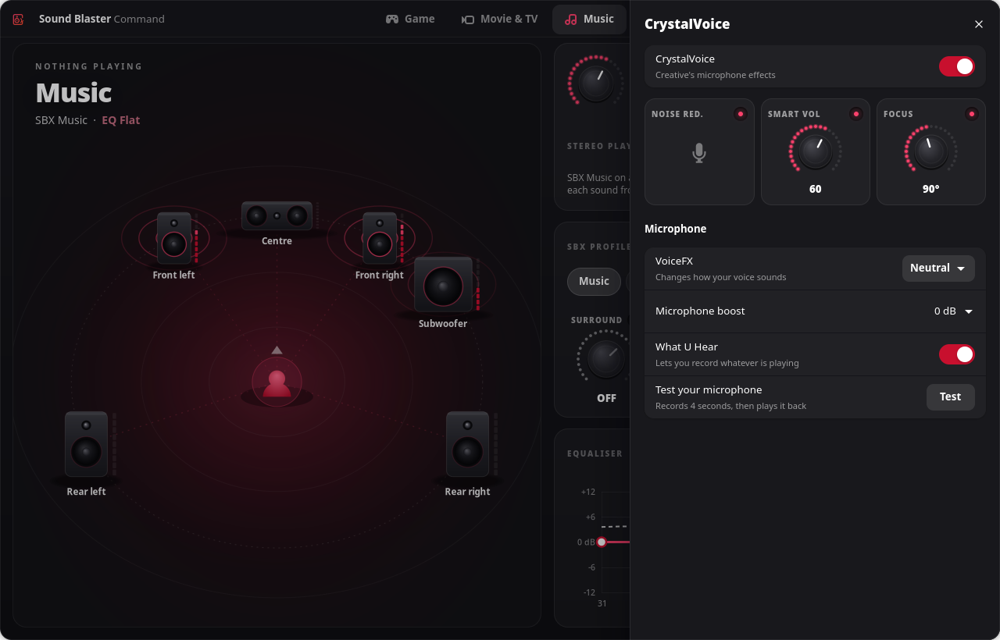<br>
<b>CrystalVoice.</b> Noise Reduction, Smart Volume, Focus (how wide the mic listens), VoiceFX, mic boost,
What U Hear and a record-and-play-back test.</td>
</tr>
<tr>
<td>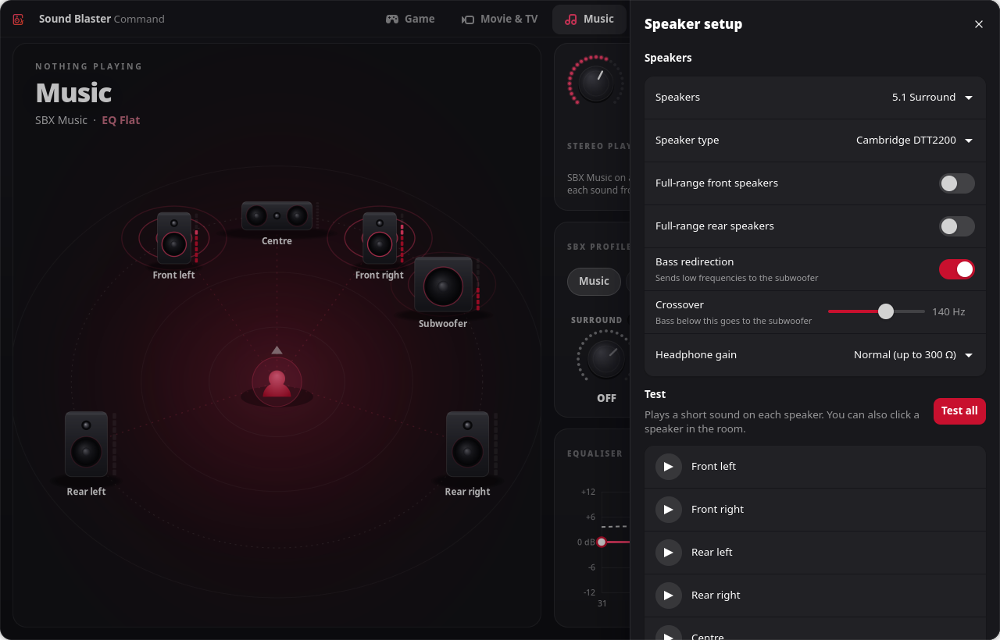<br>
<b>Speaker setup.</b> 2.0 to 5.1, speaker type (including Cambridge SoundWorks DTT2200), full-range
fronts/rears, bass redirection and crossover, headphone gain, and a test sound for every speaker.</td>
<td>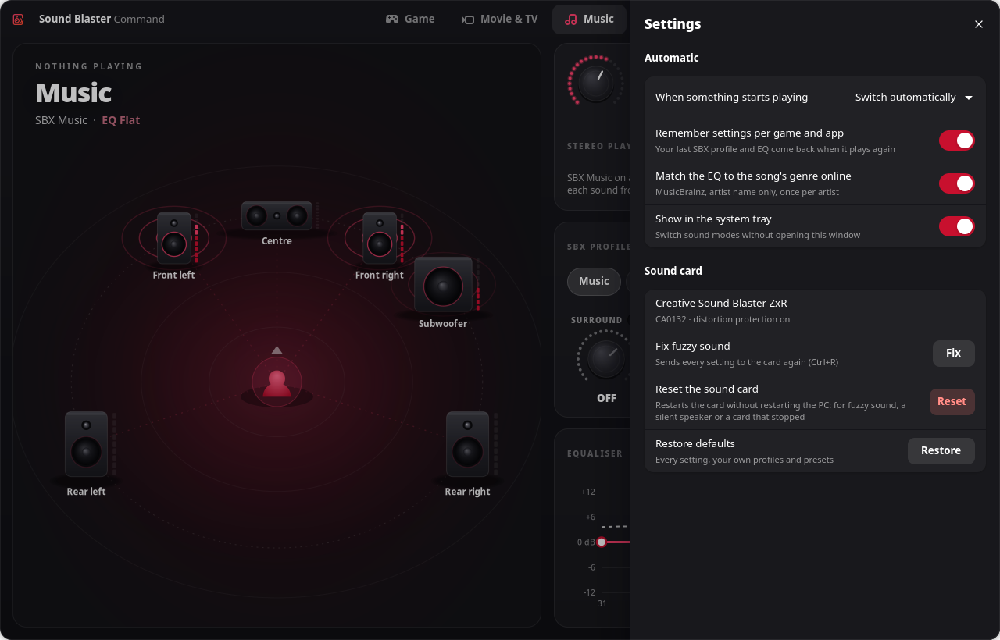<br>
<b>Settings.</b> What to do when something starts playing, per-game memory, online genre lookup, the tray
icon, and fixes: resend everything, reset the card, restore defaults.</td>
</tr>
</table>

## What it fixes on Linux

These are real problems with the ZxR on a stock Linux system, found while building this:

| Problem | What this app does |
|---|---|
| **Fuzzy, distorted sound at high volume.** The driver puts the card's Front/Surround/Centre/LFE sliders at +9 dB and PipeWire drives them as hardware volume, so the card clips. | Pins the card's own sliders at 0 dB and lets PipeWire do volume in software (WirePlumber `api.alsa.soft-mixer`). **Speaker boost** lets you deliberately go up to +9 dB again if you want Windows-level loudness. |
| **5.1 speakers in the wrong places.** The ZxR's DSP expects Windows channel order. | Sets the 5.1 output to `FL,FR,FC,LFE,RL,RR`, so every channel reaches the right speaker. |
| **SBX Bass does nothing on 5.1 or 2.1.** In `ca0132_effects_set` the driver forces X-Bass off whenever the speakers have a subwoofer. | Applies the Bass knob through the card's own equaliser instead (up to +8 dB below the Bass crossover), and bass redirection sends it to the subwoofer. The EQ graph shows it as a dashed line. |
| **Spotify (Flatpak) never reaches the other speakers.** Its stream is labelled `aux0,aux1`, which PipeWire won't place. | Re-labels such streams so they play on the front speakers like any stereo source. |
| **Centre, sub or rear right silent after a boot, sleep or reset.** The card's sound processor sometimes misses the start-up state of those outputs, and the driver never sends it again. Only a lucky restart brought them back. | Switches those outputs off and on again a couple of seconds after the card starts, so the processor picks them up (all six channels in 8 of 8 test restarts). The [driver patch](driver/README.md) does the same inside the driver. |
| **Subwoofer crossover wrong.** The driver replaces the bass redirection crossover with the X-Bass one whenever it redoes the speaker setup, so the sub got less bass than set. | Re-sends the crossover after every change. The driver patch fixes the bug itself, and two smaller ones in the same code. |
| **Settings lost after sleep or a card reset.** The driver resets the card to defaults (2.0, every effect on). | A small background service puts your settings back whenever the card comes back. Optional root helpers add a password-free **Reset the sound card** button. |
| **Effects and EQ are a wall of ALSA controls.** | Creative's profiles and presets with their real values, read from the driver. |

## Supported cards and systems

| Sound card | Status |
|---|---|
| **Sound Blaster ZxR** (Sound Core3D / CA0132, PCI `1102:0012`, main codec subsystem `1102:0033`, with the DBpro daughterboard) | **Supported and tested**: every feature, 2.0 to 5.1 speakers and headphones. Developed with Cambridge SoundWorks DTT2200 5.1 speakers. |
| Sound Blaster Z / Zx, AE-5, AE-5 Plus, AE-7, Recon3D (other PCIe CA0132 cards) | **Untested.** The app finds them and skips controls a card doesn't have, so the basics may work; ZxR-only parts (DBpro input, 600 Ω headphone gain) won't. Reports are welcome. |
| Recon3Di motherboard audio, USB Sound Blasters (G3, G6, X3, X4 ...) | **Not supported.** |

| System | Status |
|---|---|
| **Linux** with PipeWire, WirePlumber and pipewire-pulse, GTK 4.14+ and libadwaita 1.6+ | **Supported.** Developed and tested on CachyOS (Arch-based), Linux 7.3, KDE Plasma 6 on Wayland. Current Arch, Fedora 41+, Ubuntu 24.10+ and Debian 13+ have the right library versions but are untested. Works on GNOME too; the tray icon needs StatusNotifierItem support (the AppIndicator extension on GNOME). |
| Linux with PulseAudio only, or Ubuntu 24.04 and older (libadwaita 1.5) | **Not supported.** The app configures PipeWire and WirePlumber. |
| Windows, macOS | **No.** On Windows, use Creative's own Sound Blaster Command. |
| **Optional driver patch** ([`driver/`](driver/README.md)) | Linux **6.17 or newer** (the driver moved to `sound/hda/codecs/` in 6.17), tested on 7.3. Needs your kernel's headers. The module is unsigned, so it won't load where Secure Boot enforces module signatures. You don't need it: the app works around the same problems on the stock driver. |

## Install

### Requirements

- Linux with **PipeWire**, **WirePlumber** and **pipewire-pulse** (for `pactl` and `parec`)
- **GTK 4.14+** and **libadwaita 1.6+**
- **Rust** (edition 2024, so 1.85 or newer) to build
- systemd (user services, `busctl`), `curl`; optional: `notify-send`, a StatusNotifierItem tray (KDE Plasma, or the AppIndicator extension on GNOME)
- A **Creative Sound Blaster ZxR**; see [Supported cards and systems](#supported-cards-and-systems)

On Arch / CachyOS:

```sh
sudo pacman -S --needed rust gtk4 libadwaita alsa-lib pipewire pipewire-pulse wireplumber curl libnotify
```

### Build and install (no sudo)

```sh
git clone https://github.com/ImZoomBoy/soundblaster-command-linux.git
cd soundblaster-command-linux
./install.sh
```

This builds the app, installs it to `~/.local/bin/sbcommand` with a menu entry and icon, and starts the
`sbcommand-watch` user service, which keeps your settings on the card and runs the tray icon.
The first run writes small PipeWire/WirePlumber config files, so sound may stop for a second once while they load.

Optional, with sudo: the password-free **Reset the sound card** button (and a sleep hook that is off by default).

```sh
sudo packaging/root/install-root-helpers.sh
```

If sound or video stalls after waking from sleep, also run `sudo bash packaging/root/boot-and-sleep-fix.sh`
and restart. It adds `iommu=pt` to the kernel command line, which stopped the card's IOMMU errors after sleep.
It does this automatically on Limine (CachyOS's default boot loader) and prints the steps for GRUB and
systemd-boot.

To remove it: `./install.sh --uninstall` (your settings in `~/.config/sbcommand` are kept).

Optional, the [driver patch](driver/README.md): `sh driver/build.sh` (downloads and builds the matching driver
source, no sudo), then `sudo sh driver/install.sh`. Sound stops for a few seconds while the card reloads.

## Using it

Open **Sound Blaster Command** from your app menu, or:

```sh
sbcommand                # the window
sbcommand mixer          # open straight to a panel: mixer, crystalvoice, setup, settings
sbcommand apply          # send the saved settings to the card (what the service does at login)
sbcommand detect         # read-only: what's playing and what the app would pick
sbcommand selftest       # drive every control in a dry run (no card, temporary settings)
```

Tips:

- **Knobs turn:** drag round them clockwise or anticlockwise, scroll, or focus one and use the arrow keys.
  Turning a knob switches its effect on; the small LED above it switches it off.
- **Click a speaker** in the room to hear a test sound on it.
- **Click the signal path** in the capsule to see each step the sound takes. The capsule stays when you
  pause, and shows any app or browser tab that's playing, even ones the app doesn't recognise.
- **Speakers ↔ headphones always asks first**, so you never switch by accident.
- When a game or app plays again, your last **profile and EQ for it come back**, with an Undo.

## Privacy and safety

- **No AI, no telemetry, no accounts.** Everything runs locally.
- The only network use: **MusicBrainz** (artist name only, once per artist, cached; can be switched off) to
  match the Music EQ to a song's genre, and downloading the **cover art** the player itself reports.
- The **level meters** only *read* the card's output monitor while the window is open. Nothing is recorded or played.
- The app never restarts PipeWire, pipewire-pulse or WirePlumber during normal use (that would cut sound
  in your browser). It only writes their config files when a setting really needs it.
- Card controls are written directly through ALSA; anything slow runs on a background thread, so the window
  never freezes.

## How it works

| Module | Does |
|---|---|
| `model.rs` | Settings, Creative's SBX profiles and EQ presets (exact driver values), the ALSA control values for each setting, Pure, Speaker boost, per-app memory |
| `card.rs` | Writes the card's ALSA controls and hardware levels |
| `system.rs` | PipeWire / WirePlumber: 5.1 channel order, soft-mixer, extra outputs (2.1, stereo), stream re-labelling, stereo on the rears or all speakers (per-stream upmix), volume |
| `worker.rs` | Background thread for all card and audio work; the `watch` service; what's-playing detection |
| `detect.rs` | Tells Game / Movie & TV / Music from the playing streams, MPRIS players and Steam/Proton/Wine processes |
| `media.rs` | Now playing: MPRIS metadata, stream format from PipeWire, Steam game names and artwork |
| `genre.rs` | Song genre → Creative EQ preset (rules, no AI), with MusicBrainz lookups |
| `meters.rs` | Live per-speaker levels from the card's monitor (`parec`) |
| `room.rs`, `dash.rs` | The custom-drawn room, knobs, LED meters, EQ curve and signal-path dots (cairo) |
| `ui.rs` | The GTK 4 / libadwaita window |
| `tray.rs` | The tray icon (StatusNotifierItem via `ksni`) |
| `selftest.rs` | `sbcommand selftest`: clicks through every control and checks the settings follow |

## Development

```sh
cargo test               # unit tests (model, detection, genres, media)
cargo build --release
./target/release/sbcommand selftest   # dry run: never touches the card or your settings
```

`SBCOMMAND_DRYRUN=1` prints card writes instead of making them; `SBCOMMAND_CONFIG_DIR` points settings
elsewhere. Screenshots like the ones above come from the app itself:

```sh
SBCOMMAND_DRYRUN=1 SBCOMMAND_CONFIG_DIR=/tmp/sbc SBCOMMAND_DEMO_MEDIA=music \
SBCOMMAND_DEMO_ART=assets/demo/music.png SBCOMMAND_SHOT_SIZE=1280x820 \
SBCOMMAND_SHOT=shot.png ./target/release/sbcommand
```

Helper scripts in `dev/`:

| Script | Does |
|---|---|
| `dev/isolated-kwin.sh "<cmd>"` | Runs a GUI command in a private virtual KWin, apart from your desktop (use it for `selftest`) |
| `dev/screenshots.sh` | Retakes every screenshot in `docs/screenshots` |
| `dev/where-is-each-channel.sh` | Silent check that each of the six channels lands where it should in PipeWire |
| `sudo sh dev/pin-sense.sh` | Read-only: which output sockets the card detects a plug in, and how each output is set up |

[`capture/`](capture/README.md) holds the tools that found the silent-channel bug:
- `capture/dsp-probe.sh` records each output of the card's sound processor and shows which channel reaches it,
  without listening. It needs the test driver (`sh driver/build.sh --dev`).
- The scripts that captured Creative's Windows driver starting the card, in a virtual machine.

The demo tracks, film and game (*Neon Rain*, *Starfall*, *Night Circuit*) and their artwork are made up for these screenshots.

Contributions are welcome, especially tests on other CA0132 cards (Sound Blaster Z, ZxR variants, Recon3D, AE-5).

## License

[GPL-3.0-or-later](LICENSE). Copyright © 2026 the Sound Blaster Command for Linux contributors.
