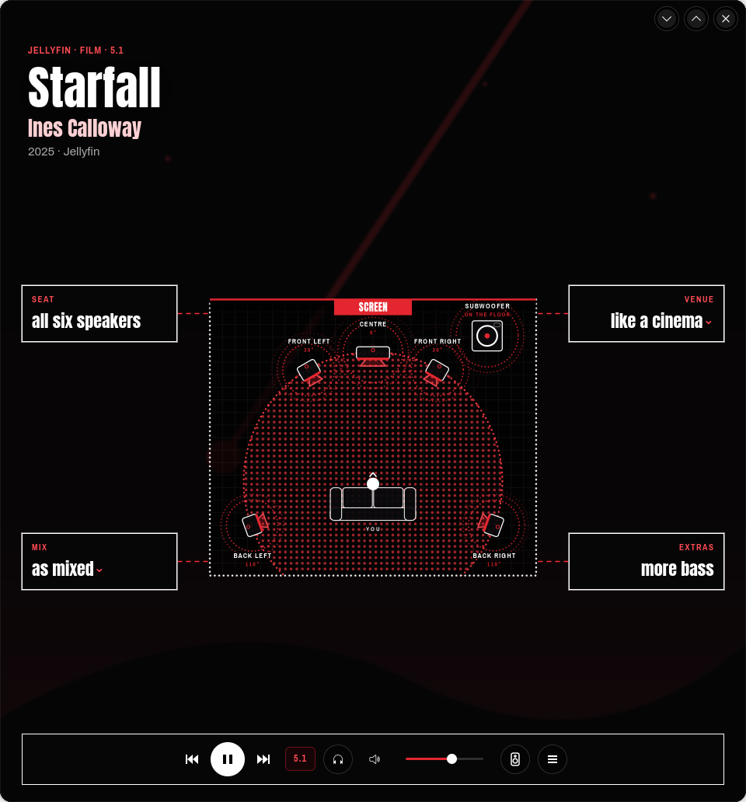
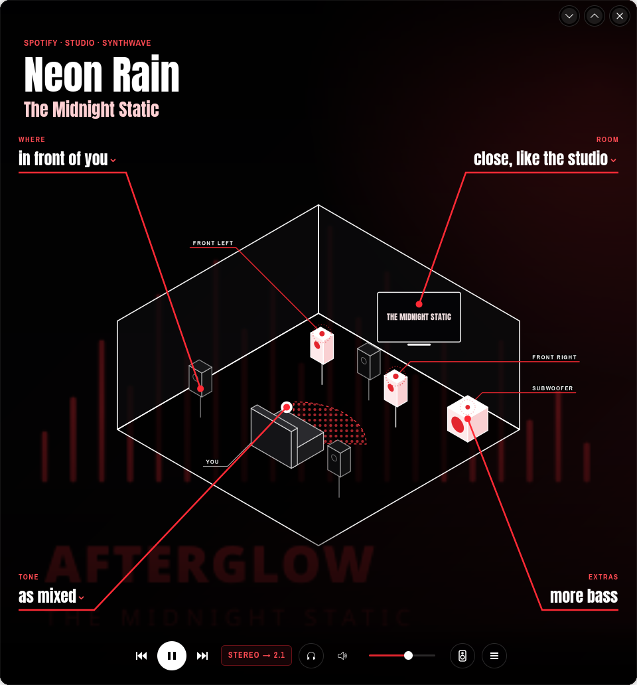
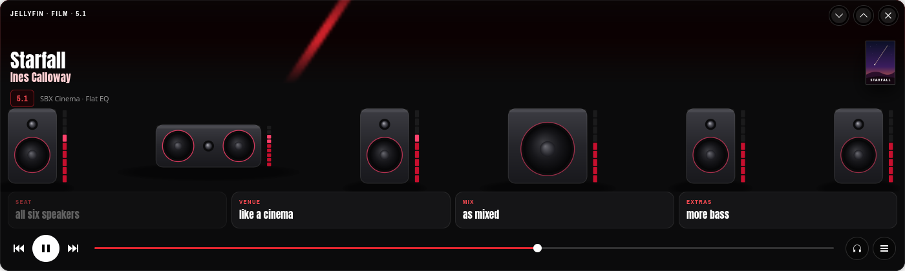
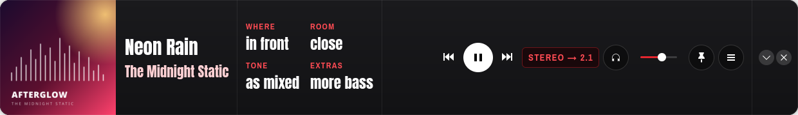

<div align="center">


# Sound Blaster Command for Linux

**A native control panel for the Creative Sound Blaster ZxR on Linux.**<br>
Creative's SBX effects and profiles, the equaliser, speaker setup and microphone effects, plus fixes for the card's Linux driver.

[](LICENSE)


</div>

Creative only makes Sound Blaster Command for Windows. On Linux the ZxR works, but its DSP, equaliser,
speaker setup and microphone effects are hidden behind dozens of raw ALSA controls, and a few of the
defaults are actively bad (more on that in [What it fixes on Linux](#13-what-it-fixes-on-linux)). This app
puts all of it in one window, works around those defaults, and keeps the card on your settings.

This page is the app's manual: what it does, how it works, and every screen in it.

> **Not affiliated with Creative Technology.** "Sound Blaster", "SBX", "CrystalVoice", "Crystalizer" and
> "Scout Mode" are Creative's trademarks; they're used here only to name the features of their hardware.

---

## Contents

1. [About the app](#1-about-the-app)
2. [Install](#2-install)
   - [Requirements](#requirements) · [Build and install](#build-and-install) · [Optional extras](#optional-extras) · [Uninstall](#uninstall)
3. [How the app works](#3-how-the-app-works)
   - [The window, the background service and the tray](#the-window-the-background-service-and-the-tray)
   - [Knowing what's playing](#knowing-whats-playing)
   - [Each kind of content keeps its own sound](#each-kind-of-content-keeps-its-own-sound)
   - [Plain words for Creative's settings](#plain-words-for-creatives-settings)
   - [Several apps at once](#several-apps-at-once)
   - [When the card restarts](#when-the-card-restarts)
4. [The main page](#4-the-main-page)
   - [A tour of the page](#a-tour-of-the-page) · [Music](#music) · [Films and TV](#films-and-tv) · [Games](#games) · [Sport, online video and streams](#sport-online-video-and-streams) · [When nothing is playing](#when-nothing-is-playing)
5. [The four sound choices](#5-the-four-sound-choices)
   - [Where](#where) · [Room](#room) · [Tone](#tone) · [Extras](#extras)
6. [Themes and layouts](#6-themes-and-layouts)
   - [The four themes](#the-four-themes) · [The seven layouts](#the-seven-layouts) · [Defaults for each kind](#defaults-for-each-kind)
7. [Every window size](#7-every-window-size)
   - [Half a screen](#half-a-screen) · [The Remote and Over your shoulder, mini](#the-remote-and-over-your-shoulder-mini) · [The Strip](#the-strip)
8. [The control centre](#8-the-control-centre)
   - [Sound](#sound) · [Mixer](#mixer) · [Microphone](#microphone) · [Speakers](#speakers) · [Look and feel](#look-and-feel) · [Settings](#settings)
9. [Testing your speakers](#9-testing-your-speakers)
10. [The signal path](#10-the-signal-path)
11. [The tray icon](#11-the-tray-icon)
12. [Sound reference](#12-sound-reference)
    - [SBX effects](#sbx-effects) · [SBX profiles](#sbx-profiles) · [Game profiles](#game-profiles) · [Equaliser presets](#equaliser-presets) · [Pure](#pure) · [Stereo plays on](#stereo-plays-on) · [Bass and the subwoofer](#bass-and-the-subwoofer)
13. [What it fixes on Linux](#13-what-it-fixes-on-linux)
14. [Supported cards and systems](#14-supported-cards-and-systems)
15. [Command line and shortcuts](#15-command-line-and-shortcuts)
16. [Privacy and safety](#16-privacy-and-safety)
17. [Troubleshooting](#17-troubleshooting)
18. [For developers](#18-for-developers)
19. [License](#19-license)

---

## 1. About the app

Sound Blaster Command for Linux does what Creative's app does on Windows, and a little more:

- **What's playing fills the window.** The title, the artist or studio, credits and a short bio, the cover,
  and behind it all the artist's photos printed in red, a game's official art, or a film's stills.
- **A room that follows what's playing**, with your own speakers in it, each lit by its live level: the
  artist's studio for a song, a concert hall or a stadium for a live recording, a cinema for a film, a gaming
  room with a monitor for a game, a scoreboard for a match. Tap a speaker to hear it on its own.
- **Four sound choices in plain words** (where the sound plays, the room, the tone and extras) that set
  Creative's real SBX profiles, effects and equaliser.
- **Each kind of content keeps its own sound.** Music, films, TV, games, sport, online video and streams each
  remember their own profile, equaliser, tone and speakers, and switch by themselves when they start.
- **Creative's exact values:** the SBX profiles and equaliser presets from Creative's Sound Blaster Command
  3.4.98, its 14 game profiles, and the five SBX effects with their knobs.
- **Four themes, seven layouts, and a design for every window size,** from a full screen down to a thin
  76-pixel strip for the edge of a screen.
- **Fixes for the card on Linux:** distortion at high volume, 5.1 channels in the wrong places, silent
  speakers after a restart, SBX Bass doing nothing with a subwoofer, settings lost after sleep.
- **A tray icon and a background service,** so the card keeps your settings and the sound switches even
  when the window is closed.

No accounts, no telemetry, no AI. The only things it looks up online are pictures and details for what's
playing, and you can switch that off ([Privacy and safety](#16-privacy-and-safety)).

## 2. Install

### Requirements

- Linux with **PipeWire**, **WirePlumber** and **pipewire-pulse** (for `pactl` and `parec`)
- **GTK 4.14+** and **libadwaita 1.6+**
- **Rust** (edition 2024, so 1.85 or newer) to build
- systemd (user services, `busctl`), `curl`; optional: `notify-send`, a StatusNotifierItem tray (KDE Plasma, or the AppIndicator extension on GNOME)
- Optional, for game trailers: `ffmpeg` (saves Steam's trailer streams once) and the GStreamer plugins GTK plays
  video with (`gst-plugins-good`, `gst-libav`). Without them the pictures still show.
- A **Creative Sound Blaster ZxR**; see [Supported cards and systems](#14-supported-cards-and-systems)

On Arch / CachyOS:

```sh
sudo pacman -S --needed rust gtk4 libadwaita alsa-lib pipewire pipewire-pulse wireplumber curl libnotify ffmpeg gst-plugins-good gst-libav
```

### Build and install

No sudo needed:

```sh
git clone https://github.com/ImZoomBoy/soundblaster-command-linux.git
cd soundblaster-command-linux
./install.sh
```

This builds the app, installs it to `~/.local/bin/sbcommand` with a menu entry and icon, and starts the
`sbcommand-watch` user service, which keeps your settings on the card and runs the tray icon.
The first run writes small PipeWire/WirePlumber config files, so sound may stop for a second once while they load.

Open **Sound Blaster Command** from your app menu, or run `sbcommand`.

### Optional extras

- **A password-free Reset button** (and a sleep hook that is off by default), with sudo:

  ```sh
  sudo packaging/root/install-root-helpers.sh
  ```

- **If sound or video stalls after waking from sleep,** run `sudo bash packaging/root/boot-and-sleep-fix.sh` and
  restart. It adds `iommu=pt` to the kernel command line, which stopped the card's IOMMU errors after sleep.
  It does this automatically on Limine (CachyOS's default boot loader) and prints the steps for GRUB and
  systemd-boot.
- **The [driver patch](driver/README.md)** fixes the same driver bugs inside the driver: `sh driver/build.sh`
  (downloads and builds the matching driver source, no sudo), then `sudo sh driver/install.sh`. Sound stops for
  a few seconds while the card reloads. You don't need it: the app works around the same problems on the stock
  driver.

### Uninstall

`./install.sh --uninstall` removes the app, the service and the menu entry. Your settings in
`~/.config/sbcommand` are kept.

## 3. How the app works

### The window, the background service and the tray

The app comes in three parts:

| Part | What it does |
|---|---|
| **The window** (`sbcommand`) | Shows what's playing and every setting. Closing it closes only the window; the card keeps its settings. |
| **The background service** (`sbcommand-watch`) | A systemd user service started at login. It sends your saved settings to the card at login and whenever the card comes back (after sleep, a reset or a driver reload), switches the sound when something new starts playing, even with the window closed, and runs the tray icon. |
| **The tray icon** | The common switches without opening the window. Click it to open the window. |

Your settings are kept in `~/.config/sbcommand/settings.json`. Pictures and details looked up online are
kept in `~/.cache/sbcommand`.

### Knowing what's playing

The app watches three things, without recording anything:

- the audio streams PipeWire is playing, and which app each one belongs to;
- the media players that say what they're playing (MPRIS: Spotify, browsers, Jellyfin, VLC and most others),
  which give the title, the artist, the album, the cover and the stream's format;
- game processes: Steam, Proton and Wine games are recognised by their process, and Steam games by their
  Steam number.

From the player, the title and the details it looks up, it decides what kind of thing is playing: a studio
song, a live recording from a small venue or a stadium, a film, an episode of a series, a game, a match
or race, an online video, or a bare stream. Each kind gets its own page ([The main page](#4-the-main-page))
and its own sound.

### Each kind of content keeps its own sound

There are seven kinds: **Music**, **Films**, **TV**, **Games**, **Sport**, **Online video** and **Streams**.
Each keeps its own SBX profile, equaliser, tone, where stereo plays, and SBX on or off. When you change the
sound while something plays, it's remembered for that kind.

When something new starts playing, the app picks its sound in this order:

1. the sound for its kind;
2. if you've used that app or game before, your last profile and equaliser for it (**Remember settings per
   game and app**), with an Undo;
3. for 14 games, Creative's own profile for that game ([Game profiles](#game-profiles)), unless you've chosen
   your own for it.

For music, the equaliser can also follow each song's genre (**Match the EQ to the song's genre**), so rock gets
Creative's Rock and hip hop gets Hip Hop.

Only your own changes are remembered, never the automatic switches. **Settings → When something starts
playing** decides what happens: **Switch automatically**, **Suggest a switch** (it offers the switch and you
press it), or **Do nothing**.

### Plain words for Creative's settings

Creative's app shows knobs and profile names. The page shows four choices in plain words instead: *in front of
you*, *close, like the studio*, *a little warmer*, *clearer voices*. Each one sets the real thing (an SBX
profile, an effect, the equaliser), and the small print under each option says exactly what. The full controls,
knob by knob, are in the [control centre](#8-the-control-centre).

### Several apps at once

The card has one sound processor, so only one app at a time can set its SBX effects and equaliser. The app
picks which by rank: a game beats a film or video, which beats music; among equals, the newest wins.

Every other app still gets its own sound: an equaliser inside its own stream, worked out so that after the
card's equaliser it hears its own kind's curve, and its own *stereo plays on*. So music playing beside a game keeps its music sound instead of sounding
like the game. While music plays beside a game, the card's effects are eased for both: Surround halved and Smart
Volume off (unless Scout Mode is on). Games and players start and stop their streams often, so this is held
steady: it starts once both have played for 4 seconds and ends 10 seconds after one stops.

**Settings → Each app its own sound** turns this off.

### When the card restarts

After sleep, a card reset, a driver reload or a reboot, the Linux driver puts the card back to its defaults
(2.0 speakers, every effect on). The background service puts your settings back within a few seconds. It also
switches the centre, subwoofer and surround outputs off and on again, because the card's processor sometimes
misses their start-up state and stays silent on them ([What it fixes on Linux](#13-what-it-fixes-on-linux)).

## 4. The main page

The page is the whole window: there's no title bar. What's playing fills it, the theme draws the room, and the
sound choices and controls sit along the bottom.

### A tour of the page


1. **The kicker** (small red capitals): the app, the kind and the genre, for example *Spotify · Studio · Synthwave*.
2. **The title block:** the title, then the artist (or the studio, for films and games). Songs show credits
   below it (track, album, genre, length); films, series, games and sport show one line of year and app
   instead. A short bio follows when there's room.
3. **The background:** the artist's photos printed in red, a game's official art, or a film's stills.
4. **The room,** drawn by the [theme](#the-four-themes), with your speakers in it. Each speaker lights up and
   pulses with its live level; speakers that aren't playing stay dark. **Tap a speaker** to hear a test sound on it.
5. **The corner** (top right): for a game, the big speaker count (*5.1*) and how many of your speakers play;
   for a live recording, the venue and the date. Films and series have a ticket across the top instead.
6. **The cover**, beside the title or large at the bottom left, depending on the [layout](#the-seven-layouts).
7. **The sound choices:** [Where, Room, Tone and Extras](#5-the-four-sound-choices).
8. **The controls** (bottom right): previous, play or pause, next; **the readout** (click it for the
   [signal path](#10-the-signal-path)); the headphones button; mute and volume; the
   [speaker test](#9-testing-your-speakers); and **☰**, which opens the [control centre](#8-the-control-centre).
9. **The window buttons** (top right): minimise, maximise and close. Drag any empty part of the page to move the window.

### Music

A **studio song** plays in the artist's studio: their name in neon on the wall, and a shelf of their other
albums with the covers. A stereo song plays on the front speakers and the subwoofer; the other speakers wait,
dark, unless you choose *all around you*.

A **live recording** moves to a concert hall, or a stadium for a big open-air show, with the venue and the date
in the corner. Its Room choice is called **Venue** and offers *like the concert hall* and *like a stadium*.

### Films and TV


A film or series gets a **ticket** across the top: *Admit one*, the app and the screen, the source, a barcode
and the number of speakers. The room is a cinema: its screen shows the title for a few seconds, then the film's
stills. A trailer only plays there when you press its play button. A 5.1 film plays on all six speakers by
itself. The choices are called **Seat**, **Venue**, **Mix** and **Extras**.

### Games


A game's art comes from Steam's own files first, then its store page, or your Playnite library. The room has a
**monitor**: the game's logo for a few seconds, then its trailer once (muted), then its pictures, changing every
10 seconds.

- **Point at the monitor** for its buttons: previous and next picture, play or stop the trailer, its sound,
  and full screen.
- **Full screen** shows the pictures large, changing every 10 seconds, with *Play the trailer · with sound*.
  The arrow keys move between pictures and Esc goes back. A trailer that's playing keeps playing between the two.

The choices are called **Speakers**, **Mode**, **Tone** and **Extras**, and Extras adds *hear footsteps sooner*
(Scout Mode), which is only for games.

### Sport, online video and streams

A **match** (a title like *Home v Away*) puts a scoreboard on the room's big screen, with three-letter team
names. Its choices are **Crowd**, **Atmosphere**, **Tone** and **Commentary**, and Atmosphere offers *in the
stands*, *like a big screen* and *quietly, for late at night*.

**Online video** (YouTube, Twitch) and **streams** use the slim dock and start from the film and TV sound.

### When nothing is playing

The page says *Nothing playing*, with the kind whose sound is set and its profile in place of the title (for
example *Music* and *SBX Music*). Everything still works: the choices, the control centre and the speaker test.

## 5. The four sound choices

Each choice opens a short list in plain words. The small print under each option says what it sets. The names
change with what's playing:

| Choice | Music | Films and TV | Games | Sport |
|---|---|---|---|---|
| [Where](#where) | Where | Seat | Speakers | Crowd |
| [Room](#room) | Room (Venue when live) | Venue | Mode | Atmosphere |
| [Tone](#tone) | Tone | Mix | Tone | Tone |
| [Extras](#extras) | Extras | Extras | Extras | Commentary |

### Where

Which speakers play.

| Option | What it does |
|---|---|
| *in front of you* | Stereo on the front speakers (and the subwoofer), as mixed |
| *all around you* | Stereo on the front and back speakers ([Stereo plays on](#stereo-plays-on)) |
| *on headphones* / *on the speakers* | Switches to the headphone socket or back. It always asks first, so you never switch by accident |

A 5.1 source shows *all six speakers*: it plays on every speaker by itself, so there's nothing to choose.

### Room

The SBX profile, in words. The list offers the profiles made for what's playing, any profiles of your own, and
*untouched*.

| Words | SBX profile |
|---|---|
| *close, like the studio* | Music (this app's own, for studio albums) |
| *like a live show*, *like the concert hall* | Concert |
| *like a stadium* | Arena for music (this app's own), Stadium for sport |
| *in the stands* | Stadium (sport) |
| *like a cinema*, *like a big screen* | Cinema |
| *quietly, for late at night* | Night |
| *wide, to place every sound* | Gaming |
| *tight, to hear every footstep* | FPS |
| *fast, for racing* | Racing |
| *rich, for role-playing* | RPG |
| *clear, for strategy* | Strategy |
| *big, for adventures* | Adventure |
| *made for Fortnite* (and other games) | Creative's profile for that game |
| *untouched* | SBX off: the sound as it was made ([Pure](#pure)) |

### Tone

Five steps: *much warmer*, *a little warmer*, *as mixed*, *a little brighter*, *much brighter*. Tone is a tilt
added on top of the equaliser preset: warmer gives more low end and a softer top, brighter a crisper top and less
low end. *As mixed* is the preset alone.

### Extras

Switches you can combine, each shown as on or off:

| Option | Sets |
|---|---|
| *clearer voices* (*clearer commentary* for sport) | Dialog+ |
| *more bass* | SBX Bass ([Bass and the subwoofer](#bass-and-the-subwoofer)) |
| *hear footsteps sooner* (games only) | Scout Mode |

## 6. Themes and layouts

### The four themes

The theme draws the room. Pick it in **Look and feel**; it applies to every page.

<table>
<tr>
<td width="50%"><br>
<b>Over your shoulder:</b> the room seen from behind your seat, with neon, LED walls and dot-matrix speakers
(here with the Rows layout).</td>
<td width="50%"><br>
<b>Blueprint:</b> the room as a plan from above, with the angle of each speaker, the listening zone and the
subwoofer on the floor.</td>
</tr>
<tr>
<td><br>
<b>Screenprint:</b> a printed room with solid speakers; a game's monitor hangs on the wall.</td>
<td><br>
<b>Callouts:</b> an isometric drawing with every speaker labelled; a film's screen sits on the far wall.</td>
</tr>
</table>

### The seven layouts

The layout places the sound choices and the cover.

| Layout | What it is |
|---|---|
| **Slim dock** | The sound choices on one line in the bottom dock; the cover by the title |
| **Slim dock, big cover** | The same dock; the cover large at the bottom left |
| **Rows** | The sound choices as rows at the bottom left, with the cover beside them |
| **Rows, cover by the title** | The rows at the bottom left; the cover by the title |
| **Sport-style bar** | A broadcast bar across the bottom, as on sport pages |
| **Split page, rows** | Music only: the album cover fills the left half, with the rows over it |
| **Split page, slim dock** | Music only: the album cover fills the left half; the choices in the dock |

The slim dock always stays one line. As the window narrows it shortens its words (the phrase before the
comma, then labels as tooltips, then words cut short) and grows back as it widens.

### Defaults for each kind

**Default** (the first tile) lets each kind of page use its own layout: music, films, TV and games open with
*Slim dock, big cover*; sport, online video and streams with *Slim dock*. Pick another layout and two buttons
appear: **Save for Music** (or whatever is playing) makes it that kind's default from now on, and **↺ Default**
goes back. **Your defaults** sums them up in one sentence, with **Reset** for the original defaults.

## 7. Every window size

The window picks the view that fits its size, in every theme, and switches as you resize it. The controls, ☰
and the window buttons are always there, and nothing is cut off.

| Window | What it shows |
|---|---|
| 1200 wide or more, and 600 tall or more | The full page |
| 900 to 1200 wide, 600 tall or more (Meta+Left on a 1920 × 1080 screen) | **[Half a screen](#half-a-screen)**: each theme's own layout |
| Under 900 wide or under 600 tall | **[The Remote, or Over your shoulder, mini](#the-remote-and-over-your-shoulder-mini)** |
| Under 300 tall | **[The Strip](#the-strip)** |

### Half a screen

On half a screen the cover, credits and bio make way, and the four sound choices become large tiles you can
press anywhere on. Each theme lays them out its own way, and long words shorten to fit their tile (*wide, to
place every sound* becomes *wide*). In windows under 760 pixels tall the tiles go four in a row.

<table>
<tr>
<td width="50%"><br>
<b>Over your shoulder:</b> the room across the middle, glass tiles over a dark band for the controls.</td>
<td width="50%"><br>
<b>Blueprint:</b> the plan between four outlined notes, joined to it by dashed red lines; the controls in an outlined frame.</td>
</tr>
<tr>
<td><br>
<b>Screenprint:</b> the room across the top, the title on a red band, solid red tiles with a black shadow.</td>
<td><br>
<b>Callouts:</b> the choices at the room's corners, with red lines to what each one changes: a back speaker,
the screen, where you sit, the subwoofer (or the centre speaker for voices). In a short window they move beside the room.</td>
</tr>
</table>

### The Remote and Over your shoulder, mini

Small windows show one of two compact views; pick which in **Look and feel → Small windows show**. **In big
windows too** shows it at every size.

<table>
<tr>
<td width="50%"><br>
<b>The Remote:</b> a tall card with the artist photo printed in red, the cover by the title, the readout, your
speakers with their meters, and the four choices as tiles. Each tile opens its options in a sheet from the
bottom; Done or a click on the dimmed window closes it.</td>
<td width="50%"><br>
<b>The Remote, album art:</b> with <b>The Remote's top → Album</b>, the album art whole and in colour at the top.</td>
</tr>
<tr>
<td><br>
<b>Over your shoulder, mini:</b> the main page made tall: the artist's neon sign, the six dot speakers round
you, and the four choices as rows.</td>
<td><br>
<b>The mini with a film:</b> an LED wall of dots shows the title's logo, then its stills. A match shows a scoreboard.</td>
</tr>
<tr>
<td colspan="2"><br>
<b>Wide and short:</b> when the Remote is much wider than it is tall, its room becomes a row of your speakers seen from the front.</td>
</tr>
</table>

### The Strip

One thin row for the edge of a screen, or a second screen left on all day. Open it with **☰ → The Strip**
(1240 × 76), or drag any window down to under 300 pixels tall; it keeps shrinking to 76.


From left to right: the cover, the title and artist, your six speakers with their meters (tap one to test it),
the four choices, the controls with the readout, a **pin**, **☰**, and the window's own minimise and close
buttons, in a group apart.



- **Taller,** the cover fills the Strip's height and the words and buttons grow with it; from 140 pixels tall the
  four choices sit two by two.
- **Narrower,** it puts parts away instead of cutting them off, in this order: the speakers, the readout, the
  choices, the volume, the pin, the skip buttons, the headphones button and the title.
- **The pin** keeps the Strip above other windows and on every desktop (KDE Plasma; elsewhere, use your window
  manager's own menu).
- **The Strip's ☰** starts with **Back to the full window** and ends with **Minimise** and **Quit** (the tray
  keeps switching the sound). Panels open the full window first, as they need the room.
- The choices open their lists as pop-ups, which may reach past the Strip's edge.

## 8. The control centre

**☰** at the bottom right opens the control centre: one panel above the controls, with what's playing and how
at the top (the readout, the SBX profile, the equaliser, the song), and six tabs. It keeps one size whatever you
press, and every tab fits without scrolling, in a small window too. **Done**, Esc or a click outside closes it,
and it opens again on the tab you used last. **The Strip** at the top switches to the Strip.

### Sound


- **The kind picker** (*Music* here): the sound being set. Pick another kind to hear and change its sound;
  closing the control centre goes back to what's playing.
- Beside it, the output in use (speakers or headphones; the headphones button in the controls switches it),
  and **SBX / Pure** ([Pure](#pure)).
- **Stereo plays on:** *Fronts* or *+ Rears* ([Stereo plays on](#stereo-plays-on)).
- **SBX profile:** the profiles for this kind as chips, and **⋮** for **New** (a copy of this one), **Rename**,
  **Revert** (back to Creative's values), **Delete**, **Import** and **Export** (as files you can share).
  Creative's own profiles can be changed and reverted, but not renamed or deleted.
- **The five SBX effects** in one row: Surround, Crystalizer, Bass, Smart Volume and Dialog+, each a knob with
  its power light by the value ([SBX effects](#sbx-effects)).
- **The equaliser:** the preset, the same **⋮** menu for presets, and the 10-band curve you drag. A dashed line
  shows what SBX Bass adds.

Knobs turn by dragging round them, by scrolling, or with the arrow keys. Turning a knob switches its effect on;
the small light by its value switches it off.

### Mixer


A level for each speaker with a live meter under it, and **Speaker boost** (0 to +9 dB) for Windows-level
loudness ([What it fixes on Linux](#13-what-it-fixes-on-linux) explains why the card's own levels stay at 0 dB).

### Microphone


- **CrystalVoice**, Creative's microphone effects, on or off, with **Noise reduction**, **Smart Volume** and
  **Focus** (how wide the microphone listens, in degrees).
- **Microphone level** and **Microphone boost** (0 to 30 dB).
- **VoiceFX:** changes how your voice sounds (Neutral, Robot, Orc, Elf and more).
- **What U Hear:** lets you record whatever is playing, with its own level.
- **Test your microphone:** records 4 seconds, then plays it back.

### Speakers


- **Channels:** Stereo, 2.1, 4.0, 4.1 or 5.1 Surround. Owners of 2.1 speakers pick 2.1, and PipeWire mixes 5.1
  sources down for them.
- **Brand and model:** the Cambridge SoundWorks DTT2200, or the size of other speakers (small desktop,
  bookshelf, floor-standing), or **Set by hand**. A choice here sets the switches it decides, hides them, and says
  what it set (here: fronts and rears not full-range, bass below 140 Hz to the subwoofer).
- **Set by hand** shows the switches: full-range fronts and rears, bass redirection and the crossover.
- **Headphone gain** (Normal, up to 300 Ω, or High, up to 600 Ω) shows while you're on headphones.
- **Test:** a button for each speaker, laid out like the room, and **Test all**.

### Look and feel


- **Theme** and **Layout**, as small pictures ([Themes and layouts](#6-themes-and-layouts)).
- **Your defaults:** which kinds open with which layout, in one sentence.
- **The compact views:** what small windows show (the Remote or the mini), **In big windows too**, and
  **The Remote's top** (the photo or the album art).

### Settings


**Automatic**

- **When something starts playing:** *Switch automatically*, *Suggest a switch* or *Do nothing*.
- **Remember settings per game and app:** your last SBX profile and equaliser come back.
- **Each app its own sound:** music beside a game keeps its own equaliser and speakers ([Several apps at once](#several-apps-at-once)).
- **Match the EQ to the song's genre** (MusicBrainz, the artist's name only).
- **Show in the system tray.**

**Pictures and details**

- **Look up pictures and details online:** TheAudioDB, Steam and TMDB; only names are sent. Off, the page uses
  the player's own cover art.
- **TMDB API key:** optional, for film and TV pictures (free from themoviedb.org).
- **Playnite library folder:** optional, for game art and saved trailers.

**Sound card**

- **Fix fuzzy sound** (Ctrl+R): sends every setting to the card again.
- **Reset card:** restarts the card. Sound stops for a few seconds. With the root helpers installed it needs no
  password.
- **Restore defaults:** every setting, your own profiles and presets.

## 9. Testing your speakers

There are three ways to hear each speaker on its own:

- **Tap a speaker** in the room on the page, the Remote or the Strip.
- **Speakers → Test** in the control centre: a button for each speaker, and **Test all**.
- **The speaker test**: the speaker button in the controls (in the Strip, **☰ → Speaker test**):


The room fills the window in perspective. Tap a speaker or its name to hear it, or **Walk round** to hear each in
turn, from front left round to the subwoofer. **Noise** plays a short burst of soft (pink) noise, **Voice** a voice
saying the speaker's name. Music pauses while the test is open and plays again when you close it (× or Esc).

Each test is a 6-channel sound that's silent on every channel but one, so a speaker you hear is really that
speaker. (A one-channel test would be copied to both fronts by PipeWire and sound like a centre speaker even when
the centre is dead.)

## 10. The signal path

Click the readout in the controls (*5.1*, *STEREO → 2.1*) to see every step the sound takes, coloured by
whether it's unchanged, changed or has effects added:

<table>
<tr>
<td width="50%"><br>
<b>Stereo, all around you:</b> Spotify sends 44.1 kHz stereo; PipeWire resamples it to 48 kHz and copies it to the
rear speakers, 3 dB quieter; the card adds SBX and the EQ; the fronts, rears and subwoofer play.</td>
<td width="50%"><br>
<b>A 5.1 film:</b> 48 kHz 5.1 straight through, no resampling, each channel to its own speaker.</td>
</tr>
</table>

## 11. The tray icon

The tray icon belongs to the background service, so it's there whenever you're logged in, even with the window
closed. Click it to open the window. Its menu shows what's playing and the sound in use, and has:

- the seven kinds of content (the sound being set);
- **SBX** or **Pure (no SBX effects)**;
- **SBX profile** and **Equaliser**, each a list to pick from;
- **Stereo plays on:** Fronts or + Rears;
- **Open Sound Blaster Command**.

On GNOME the tray needs the AppIndicator extension. **Settings → Show in the system tray** hides it.

## 12. Sound reference

### SBX effects

| Effect | What it does |
|---|---|
| **Surround** | Widens the sound around you |
| **Crystalizer** | Restores the punch and detail that compression takes out |
| **Bass** | Adds low end, below its crossover ([Bass and the subwoofer](#bass-and-the-subwoofer)) |
| **Smart Volume** | Evens out loud and quiet parts (Normal, Loud or Night) |
| **Dialog+** | Brings voices forward |

Each has an on/off switch and a level, in **Sound** in the control centre.

### SBX profiles

Creative's profiles, with the exact values from Creative's Sound Blaster Command for Windows (separate speaker
and headphone values where Creative has them), plus two of this app's own:

| For | Profiles |
|---|---|
| Music | **Music** (this app's own, for studio albums), **Concert**, **Arena** (this app's own: a stadium gig, wide with big bass and nothing squeezed) |
| Films, TV, video | **Cinema**, **Night** |
| Sport | **Stadium** (made for watching sport: Smart Volume and Dialog+ for the commentary), **Cinema**, **Night** |
| Games | **Gaming**, **FPS**, **Racing**, **RPG**, **Strategy**, **Adventure** |

You can make your own, rename and delete them, and export or import them as files.

### Game profiles

Creative's 14 game profiles, each with its own equaliser, are picked by themselves when that game runs: Apex
Legends, Arena of Valor, Battlefield 1, CoD: Infinite Warfare, Counter-Strike, Dota 2, Fortnite, League of Legends,
Metal Gear Solid V, Overwatch, PUBG, Project CARS, Rocket League and The Witcher 3. If you've chosen your own
sound for a game, yours wins.

### Equaliser presets

Ten bands from 31 Hz to 16 kHz. Creative's presets: **Flat**, **Acoustic**, **Classical**, **Country**,
**Dance**, **Hip Hop**, **Jazz**, **Pop**, **R&B**, **Rock**, **Vocal**, **Gaming**, **Cinema**, **Concert** and
**Night**, plus **Rock (classic)**, the Linux driver's older Rock. Drag any band to change it; **Revert** puts a
preset back to Creative's values, and your own presets can be made, exported and imported.

### Pure


Pure is SBX off: the five SBX effects (Bass and Scout Mode included) are off and their knobs grey out. The
equaliser stays on, as in Creative's own app, where SBX and the equaliser are separate switches. On the page,
Pure is the Room choice *untouched*.

### Stereo plays on

Each source plays on the speakers it was made for, by itself: a stereo song on the fronts and the subwoofer, a
5.1 film, game or track on all six. **Stereo plays on** decides only what stereo does:

- **Fronts:** the front speakers only, exactly as mixed.
- **+ Rears:** the rear speakers get a copy too, 3 dB quieter. The centre stays silent, because PipeWire's
  centre fill sounds hollow on stereo recordings.

### Bass and the subwoofer

The Linux driver turns SBX Bass off whenever your speakers have a subwoofer, so the app applies Bass through the
card's own equaliser instead (up to +8 dB). With **bass redirection** on, every speaker's bass goes to the
subwoofer, and Bass reaches everything the subwoofer plays (up to the speakers' crossover: 140 Hz for the
DTT2200), not just Creative's 80 Hz.

## 13. What it fixes on Linux

These are real problems with the ZxR on a stock Linux system, found while building this:

| Problem | What this app does |
|---|---|
| **Fuzzy, distorted sound at high volume.** The driver puts the card's Front/Surround/Centre/LFE sliders at +9 dB and PipeWire drives them as hardware volume, so the card clips. | Pins the card's own sliders at 0 dB and lets PipeWire do volume in software (WirePlumber `api.alsa.soft-mixer`). **Speaker boost** lets you deliberately go up to +9 dB again if you want Windows-level loudness. |
| **5.1 speakers in the wrong places.** The ZxR's DSP expects Windows channel order. | Sets the 5.1 output to `FL,FR,FC,LFE,RL,RR`, so every channel reaches the right speaker. |
| **SBX Bass does nothing on 5.1 or 2.1.** In `ca0132_effects_set` the driver forces X-Bass off whenever the speakers have a subwoofer. | Applies the Bass knob through the card's own equaliser instead, and bass redirection sends it to the subwoofer. The EQ graph shows it as a dashed line. |
| **Spotify (Flatpak) never reaches the other speakers.** Its stream is labelled `aux0,aux1`, which PipeWire won't place. | Re-labels such streams so they play on the front speakers like any stereo source. |
| **Centre, sub or rear right silent after a boot, sleep or reset.** The card's sound processor sometimes misses the start-up state of those outputs, and the driver never sends it again. Only a lucky restart brought them back. | Switches those outputs off and on again a couple of seconds after the card starts, so the processor picks them up (all six channels in 8 of 8 test restarts). The [driver patch](driver/README.md) does the same inside the driver. |
| **Subwoofer crossover wrong.** The driver replaces the bass redirection crossover with the X-Bass one whenever it redoes the speaker setup, so the sub got less bass than set. | Re-sends the crossover after every change. The driver patch fixes the bug itself, and two smaller ones in the same code. |
| **Settings lost after sleep or a card reset.** The driver resets the card to defaults (2.0, every effect on). | The background service puts your settings back whenever the card comes back. Optional root helpers add a password-free **Reset card** button. |
| **Effects and EQ are a wall of ALSA controls.** | Creative's profiles and presets with their exact values, read from Creative's own Sound Blaster Command data files. |

## 14. Supported cards and systems

| Sound card | Status |
|---|---|
| **Sound Blaster ZxR** (Sound Core3D / CA0132, PCI `1102:0012`, main codec subsystem `1102:0033`, with the DBpro daughterboard) | **Supported and tested**: every feature, 2.0 to 5.1 speakers and headphones. Developed with Cambridge SoundWorks DTT2200 5.1 speakers. |
| Sound Blaster Z / Zx, AE-5, AE-5 Plus, AE-7, Recon3D (other PCIe CA0132 cards) | **Untested.** The app finds them and skips controls a card doesn't have, so the basics may work; ZxR-only parts (DBpro input, 600 Ω headphone gain) won't. Reports are welcome. |
| Recon3Di motherboard audio, USB Sound Blasters (G3, G6, X3, X4 ...) | **Not supported.** |

| System | Status |
|---|---|
| **Linux** with PipeWire, WirePlumber and pipewire-pulse, GTK 4.14+ and libadwaita 1.6+ | **Supported.** Developed and tested on CachyOS (Arch-based), Linux 7.3, KDE Plasma 6 on Wayland. Current Arch, Fedora 41+, Ubuntu 24.10+ and Debian 13+ have the right library versions but are untested. Works on GNOME too; the tray icon needs StatusNotifierItem support (the AppIndicator extension on GNOME), and the Strip's pin is KDE only. |
| Linux with PulseAudio only, or Ubuntu 24.04 and older (libadwaita 1.5) | **Not supported.** The app configures PipeWire and WirePlumber. |
| Windows, macOS | **No.** On Windows, use Creative's own Sound Blaster Command. |
| **Optional driver patch** ([`driver/`](driver/README.md)) | Linux **6.17 or newer** (the driver moved to `sound/hda/codecs/` in 6.17), tested on 7.3. Needs your kernel's headers. The module is unsigned, so it won't load where Secure Boot enforces module signatures. |

## 15. Command line and shortcuts

```sh
sbcommand                # the window
sbcommand sound          # open straight to a tab: sound, mixer, crystalvoice, setup, look, settings
sbcommand speaker-test   # open the speaker test
sbcommand apply          # send the saved settings to the card (what the service does at login)
sbcommand detect         # read-only: what's playing and what the app would pick
sbcommand watch          # the background service (normally started by systemd)
sbcommand selftest       # drive every control in a dry run (no card, temporary settings)
```

| Key | Does |
|---|---|
| Esc | Closes the control centre, the speaker test or full screen |
| Ctrl+R | Fix fuzzy sound: sends every setting to the card again |
| ← → | In full screen, the previous or next picture; on a focused knob, turn it |
| ↑ ↓ | On a focused knob, turn it |

## 16. Privacy and safety

- **No AI, no telemetry, no accounts.** Everything runs locally.
- For the page's pictures and details, only names (the artist, the album, the game, the film) and Steam's game
  number are sent. Everything fetched is kept under `~/.cache/sbcommand`, so each one is asked about once
  (renewed after 30 days):
  - **MusicBrainz**: the artist's genre, to match the Music EQ (can be switched off), and the artist's other
    albums for the record shelf, with covers from the **Cover Art Archive**;
  - **TheAudioDB**: artist photos, logo and a short bio;
  - **Steam**: a game's art from Steam's own files first, then its store page (screenshots, trailer). Trailers are
    saved once with `ffmpeg` (the newest 12 are kept) and play **muted** on the monitor; sound only in full
    screen or when you turn it on;
  - **TMDB**: film and series pictures, only if you enter your own free API key;
  - your **Playnite** library folder, if you set one (read from disk, no network);
  - the **cover art** the player itself reports.
- **Settings → Look up pictures and details online** switches the page's lookups off; it then uses the player's
  own cover art. The genre lookup has its own switch.
- The **level meters** only *read* the card's output monitor while the window is open. Nothing is recorded or played.
- The app never restarts PipeWire, pipewire-pulse or WirePlumber during normal use (that would cut sound
  in your browser). It only writes their config files when a setting really needs it.
- Card controls are written directly through ALSA; anything slow runs on a background thread, so the window
  never freezes.

## 17. Troubleshooting

**A speaker is silent (often the centre, the subwoofer or rear right).** The app wakes those outputs after every
card start, which brings them back nearly every time. If one is still silent, use **Settings → Reset card**
(sound stops for a few seconds). There's no need to power the computer off. Check it with the
[speaker test](#9-testing-your-speakers).

**The sound is fuzzy or distorted.** Press **Fix fuzzy sound** (Ctrl+R) in Settings, which sends every setting
to the card again. If you raised **Speaker boost** in the Mixer, lower it.

**"The Sound Blaster isn't responding" appears.** Press **Reset card** in the banner.

**Sound or video stalls after waking from sleep.** Run the [sleep fix](#optional-extras) and restart.

**A stereo song only plays on two speakers.** That's as it was made. Choose *all around you* (or
**Stereo plays on → + Rears**) to use the rears too.

**A 5.1 film only plays on two speakers.** Check **Speakers → Channels** is 5.1 Surround, and that the player
sends 5.1 (the [signal path](#10-the-signal-path) shows what it sends).

**There's no tray icon.** On GNOME install the AppIndicator extension. Just after login the tray can take a few
seconds to appear; the service keeps trying.

**The window turned into a thin bar.** It's [the Strip](#the-strip): drag the window taller, or use
**☰ → Back to the full window**.

**The page shows no pictures.** Check **Settings → Look up pictures and details online**. Films and series need
a TMDB key for their pictures.

**Closing the window didn't remove the tray icon.** That's intended: the tray belongs to the background service,
which keeps your settings on the card.

## 18. For developers

### How it's built

Rust 2024, GTK 4 and libadwaita. The rooms are drawn with cairo, and the fonts (Anton, Archivo Narrow and Archivo)
are bundled for this app only.

| Module | Does |
|---|---|
| `model.rs` | Settings, Creative's SBX profiles and EQ presets (exact values from Sound Blaster Command 3.4.98), game profiles, each kind's sound, the ALSA control values for each setting, Pure, Speaker boost, per-app memory |
| `card.rs` | Writes the card's ALSA controls and hardware levels |
| `system.rs` | PipeWire / WirePlumber: 5.1 channel order, soft-mixer, extra outputs (2.1, stereo), stream re-labelling, stereo on the rears and each app's own EQ (per stream), volume, test sounds |
| `worker.rs` | Background thread for all card and audio work; the `watch` service |
| `detect.rs` | Tells games, films and TV, and music apart from the playing streams, MPRIS players and Steam/Proton/Wine processes; which app sets the card when several play |
| `media.rs` | Now playing: MPRIS metadata, stream format from PipeWire, Steam game names and artwork |
| `genre.rs` | Song genre → Creative EQ preset (rules, no AI), with MusicBrainz lookups |
| `meters.rs` | Live per-speaker levels from the card's monitor (`parec`) |
| `meta.rs` | What kind of thing is playing (studio song, live recording, film, series, game, match, web video) and its pictures and details: TheAudioDB, Steam, MusicBrainz and the Cover Art Archive, TMDB, Playnite; cached |
| `art.rs` | Picture processing: the page-red print, auto levels for dark game art, darkening |
| `stage.rs` | The page's layers: background pictures, the room, the title block, the corner, the cover, the sound choices (slim dock, rows, bar, half-screen tiles), the controls, the monitor video; sizes for every window |
| `ui/page.rs` | The page's behaviour: what's playing → title, credits, corner and choices; the monitor and full screen; Look and feel; which view the window's size shows |
| `ui/speaker_test.rs` | The full-screen speaker test |
| `oys.rs` | The Over your shoulder room |
| `themes.rs` | The Blueprint, Screenprint and Callouts rooms |
| `fonts.rs` | The bundled fonts |
| `mini.rs` | The compact views: the Remote, Over your shoulder, mini, and the Strip with its pin (a KWin script) |
| `room.rs`, `dash.rs` | The speakers as real cabinets with LED meters (the Remote's room, the Strip's row), knobs, the EQ curve and signal-path dots |
| `ui.rs` | The GTK 4 / libadwaita window and the control centre |
| `tray.rs` | The tray icon (StatusNotifierItem via `ksni`) |
| `selftest.rs` | `sbcommand selftest`: clicks through every control and checks the settings follow |

### Building and testing

```sh
cargo test                # unit tests (model, detection, genres, media, layouts)
cargo build --release
dev/isolated-kwin.sh "$PWD/target/release/sbcommand selftest"   # 38 checks, in a private test screen
```

The self-test drives every control in a dry run (it never touches the card or your settings), checks each theme's
half-screen layout and the Strip at several sizes, and fails on any GTK warning.

`SBCOMMAND_DRYRUN=1` prints card writes instead of making them; `SBCOMMAND_CONFIG_DIR` points settings
elsewhere. A dry run looks nothing up online; `SBCOMMAND_META_LIVE=1` allows the picture lookups anyway (and a
muted trailer), with `SBCOMMAND_DEMO_TITLE`, `SBCOMMAND_DEMO_ARTIST`, `SBCOMMAND_DEMO_ALBUM` and
`SBCOMMAND_DEMO_NOART=1` to fake what's playing. `SBCOMMAND_TMDB_KEY` is another way to give a TMDB key.
Screenshots like the ones above come from the app itself (`SBCOMMAND_SHOT_DELAY` in ms,
`SBCOMMAND_SHOT_FULL=pictures|trailer` for the full-screen view):

```sh
SBCOMMAND_DRYRUN=1 SBCOMMAND_CONFIG_DIR=/tmp/sbc SBCOMMAND_DEMO_MEDIA=music \
SBCOMMAND_DEMO_ART=assets/demo/music.png SBCOMMAND_SHOT_SIZE=1280x820 \
SBCOMMAND_SHOT=shot.png ./target/release/sbcommand
```

### Helper scripts

| Script | Does |
|---|---|
| `dev/isolated-kwin.sh "<cmd>"` | Runs a GUI command in a private virtual KWin, apart from your desktop (use it for `selftest`) |
| `dev/screenshots.sh` | Retakes every screenshot in `docs/screenshots` |
| `dev/where-is-each-channel.sh` | Silent check that each of the six channels lands where it should in PipeWire |
| `sudo sh dev/pin-sense.sh` | Read-only: which output sockets the card detects a plug in, and how each output is set up |

[`capture/`](capture/README.md) holds the tools that found the silent-channel bug:
- `capture/dsp-probe.sh` records each output of the card's sound processor and shows which channel reaches it,
  without listening. It needs the test driver (`sh driver/build.sh --dev`).
- The scripts that captured Creative's Windows driver starting the card, in a virtual machine.

The demo tracks, film and game (*Neon Rain*, *Starfall*, *Night Circuit*) and their artwork are made up for these screenshots.

Contributions are welcome, especially tests on other CA0132 cards (Sound Blaster Z, ZxR variants, Recon3D, AE-5).

## 19. License

[GPL-3.0-or-later](LICENSE). Copyright © 2026 the Sound Blaster Command for Linux contributors.
The bundled Anton, Archivo Narrow and Archivo fonts in [`assets/fonts`](assets/fonts) are under the SIL Open Font License 1.1.
