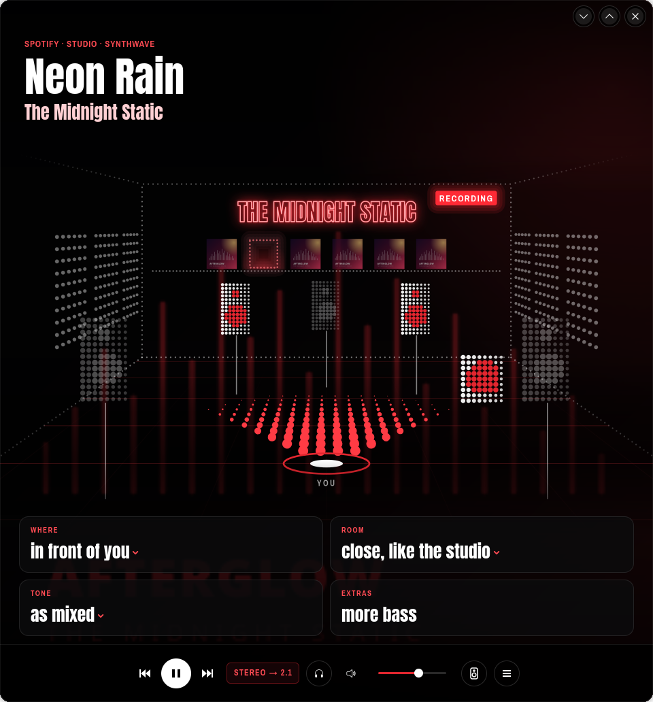
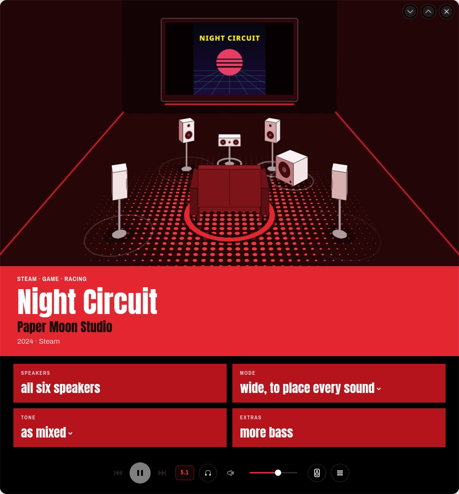
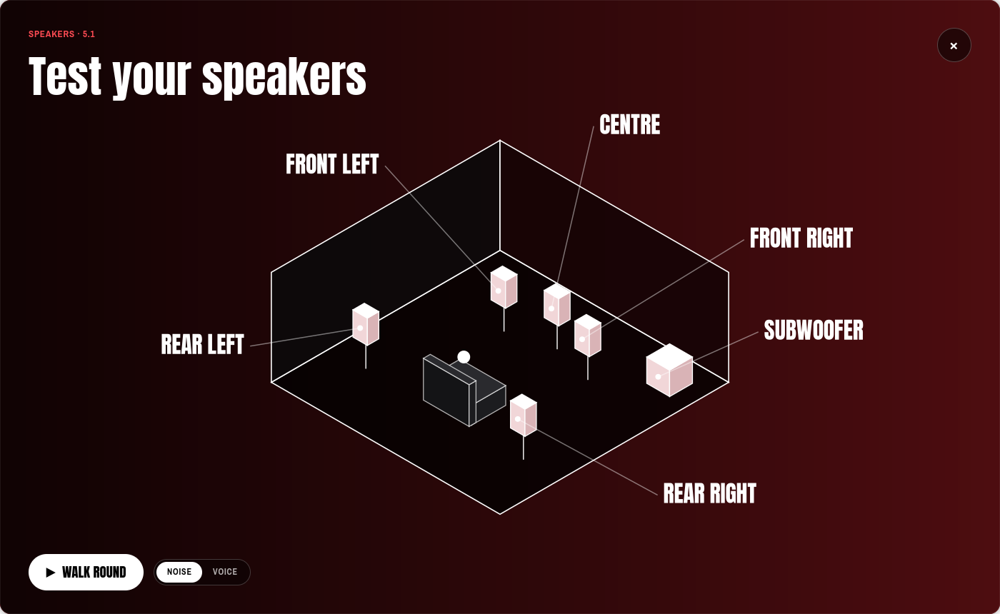

<div align="center">


# Sound Blaster Command for Linux

**Control your Creative Sound Blaster ZxR on Linux.**

[](LICENSE)


</div>

Creative only makes its Sound Blaster Command app for Windows. This is one for Linux. It shows what's playing,
lets you choose how it sounds in plain words, and keeps the card on your settings.

> Not made by or linked to Creative Technology. "Sound Blaster", "SBX", "CrystalVoice" and "Scout Mode" are
> Creative's trademarks, used here only to name their features.

## Contents

1. [What it does](#1-what-it-does)
2. [Install](#2-install)
3. [The main window](#3-the-main-window)
4. [Choosing the sound](#4-choosing-the-sound)
5. [Any window size](#5-any-window-size)
6. [The control centre](#6-the-control-centre)
7. [Testing your speakers](#7-testing-your-speakers)
8. [The tray icon](#8-the-tray-icon)
9. [Help](#9-help)
10. [Privacy](#10-privacy)
11. [More](#11-more)

## 1. What it does

- Shows what's playing: the title, the artist, the cover and pictures, with your speakers lighting up as they play.
- Lets you choose the sound in plain words, like *all around you* or *a little warmer*.
- Remembers a sound for music, films, TV, games and sport, and switches to it when one starts.
- Has Creative's own sound settings: the SBX effects and profiles, the equaliser and the microphone effects.
- Fixes problems the card has on Linux, like distortion at high volume and speakers going silent.
- Keeps your settings on the card, even after sleep and when the window is closed.

## 2. Install

You need Linux with PipeWire (most current versions have it) and a Sound Blaster ZxR.

On Arch or CachyOS, first install what it needs:

```sh
sudo pacman -S --needed rust gtk4 libadwaita alsa-lib pipewire pipewire-pulse wireplumber curl libnotify ffmpeg gst-plugins-good gst-libav
```

Then:

```sh
git clone https://github.com/ImZoomBoy/soundblaster-command-linux.git
cd soundblaster-command-linux
./install.sh
```

Open **Sound Blaster Command** from your app menu. Sound may stop for a second the first time, while it sets
things up.

To remove it, run `./install.sh --uninstall`. Your settings are kept.

## 3. The main window


- **Top left:** what's playing.
- **The middle:** a room with your speakers in it. Each one lights up as it plays. Click a speaker to hear it on
  its own.
- **Bottom left:** the four sound choices ([Choosing the sound](#4-choosing-the-sound)).
- **Bottom right:** play and pause, the volume, the headphones button, the speaker test, and **☰** for every
  setting ([The control centre](#6-the-control-centre)).

The room changes with what's playing: a studio for a song, a concert hall for a live recording, a cinema for a
film, a gaming room with a screen for a game, and a scoreboard for a match.

There are four looks to choose from in **☰ → Look and feel**:

<table>
<tr>
<td width="50%"><br><b>Over your shoulder</b></td>
<td width="50%"><br><b>Blueprint</b></td>
</tr>
<tr>
<td><br><b>Screenprint</b></td>
<td><br><b>Callouts</b></td>
</tr>
</table>

## 4. Choosing the sound

Click a choice to see its options. The small print under each option says what it changes.

| Choice | What it changes | For example |
|---|---|---|
| **Where** | Which speakers play | *in front of you*, *all around you*, *on headphones* |
| **Room** | The space it sounds like | *close, like the studio*, *like a cinema*, *untouched* |
| **Tone** | Warmer or brighter | *a little warmer*, *as mixed*, *much brighter* |
| **Extras** | Something added | *clearer voices*, *more bass*, *hear footsteps sooner* in games |

Music, films, TV, games, sport, online video and streams each remember their own sound. When one starts
playing, the app switches to its sound by itself. It also remembers your sound for each game and app.

## 5. Any window size

The window rearranges itself to fit, whatever its size.

<table>
<tr>
<td width="36%"><br><b>Half a screen:</b> a simpler layout, different in each look.</td>
<td width="36%"><br><b>Half a screen</b> in Screenprint.</td>
<td width="28%"><br><b>Small:</b> the Remote, a tall card.</td>
</tr>
</table>


**The Strip:** one thin bar for the edge of your screen. Open it from **☰ → The Strip**, or drag the window
down until it's very short. On KDE, its pin keeps it above other windows.

## 6. The control centre

**☰** at the bottom right opens every setting. **Done** or Esc closes it.


| Tab | What's in it |
|---|---|
| **Sound** | SBX on or off, the SBX profile and its five effects, and the equaliser |
| **Mixer** | A level for each speaker, and a boost for extra loudness |
| **Microphone** | Creative's microphone effects, levels, and a test |
| **Speakers** | How many speakers you have, their brand, and a test for each |
| **Look and feel** | The look, the layout, and what small windows show |
| **Settings** | Automatic switching, pictures, and buttons to fix or reset the card |

## 7. Testing your speakers

Click the speaker button at the bottom right. Click any speaker to hear it, or **Walk round** to hear them all in
turn. Choose **Noise** or a **Voice** that says each speaker's name.



## 8. The tray icon

The icon in your system tray lets you change the main settings without opening the window. Click it to open
the window. It stays there when the window is closed, because it keeps your settings on the card.

## 9. Help

**A speaker is silent.** Go to **☰ → Settings** and press **Reset card**. Sound stops for a few seconds.

**The sound is fuzzy.** Press **Fix fuzzy sound** in **☰ → Settings**, or Ctrl+R.

**A song only plays on the front speakers.** That's how it was made. Choose **Where → all around you** to use the
back speakers too.

**The window became a thin bar.** That's the Strip. Make the window taller, or choose **☰ → Back to the full
window**.

**There's no tray icon on GNOME.** Install the AppIndicator extension.

**Sound stalls after sleep.** See [the sleep fix](docs/TECHNICAL.md#optional-extras).

## 10. Privacy

- No accounts, no tracking, no AI.
- To find pictures, it sends only names (the artist, the album, the film or the game). You can turn this off in
  **☰ → Settings**.
- It never records anything. The speaker lights only read the level of what's playing.

## 11. More

[Technical details](docs/TECHNICAL.md): how it works inside, every sound setting, what it fixes in the Linux
driver, which cards and systems it supports, the optional driver patch, the command line, and notes for
developers.

License: [GPL-3.0-or-later](LICENSE). The bundled fonts are under the SIL Open Font License 1.1.
