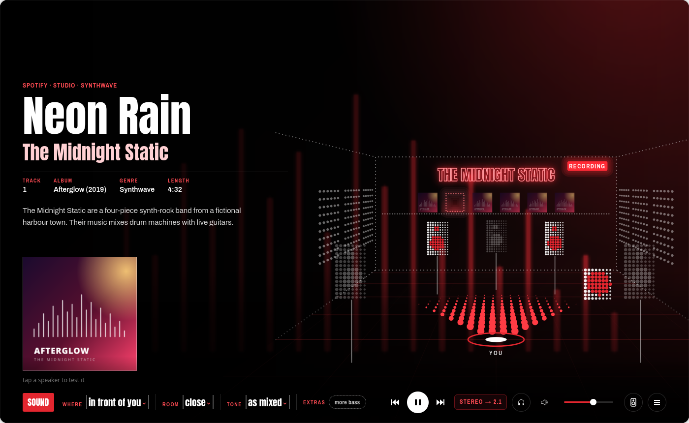
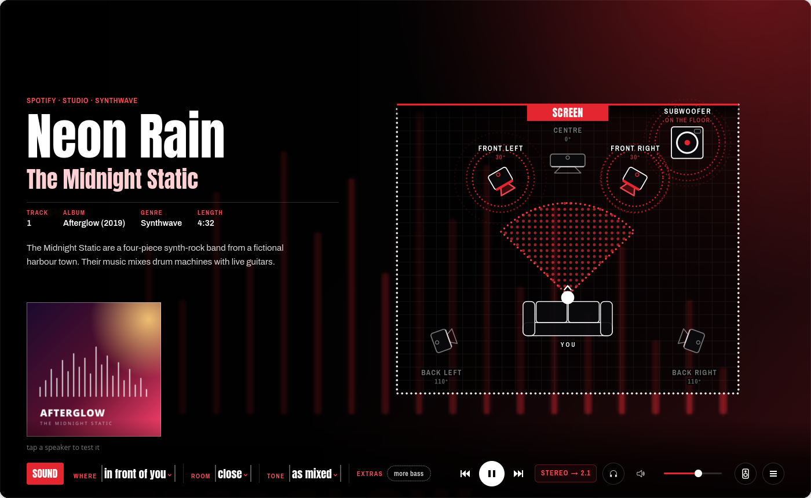
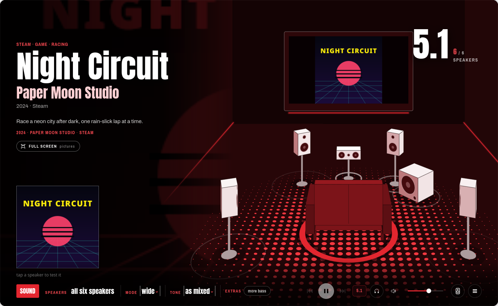
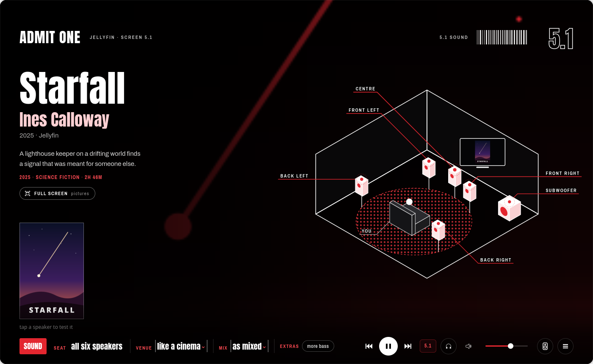
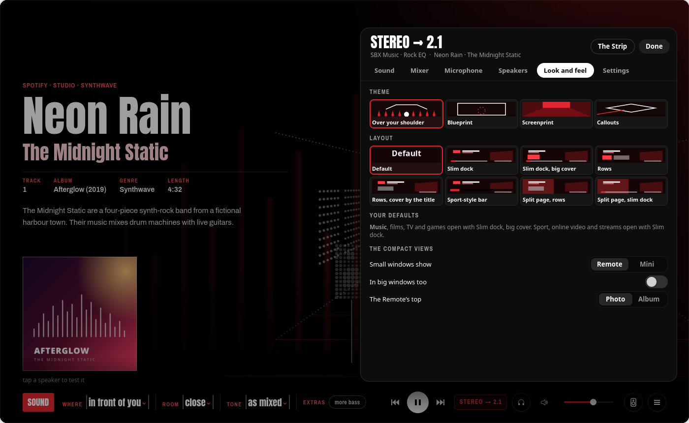
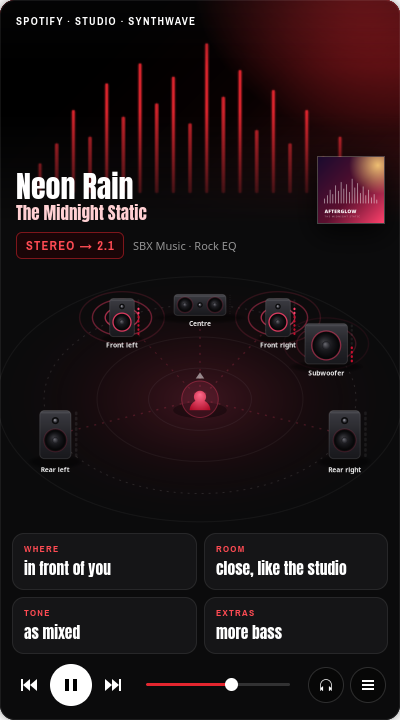
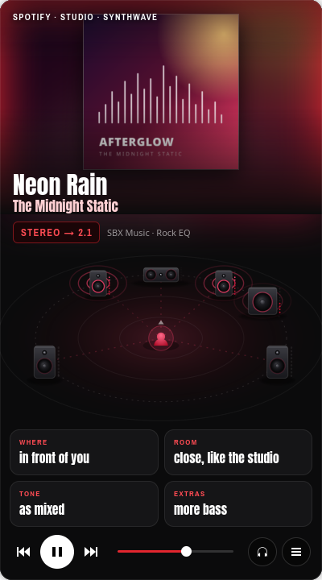
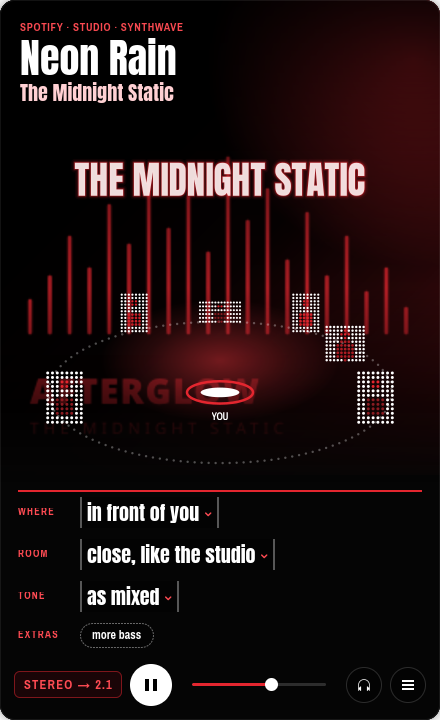
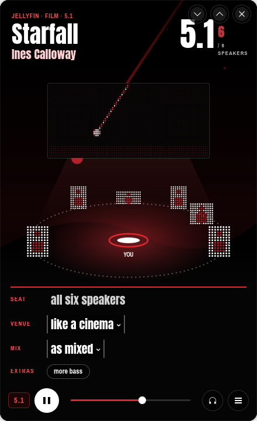
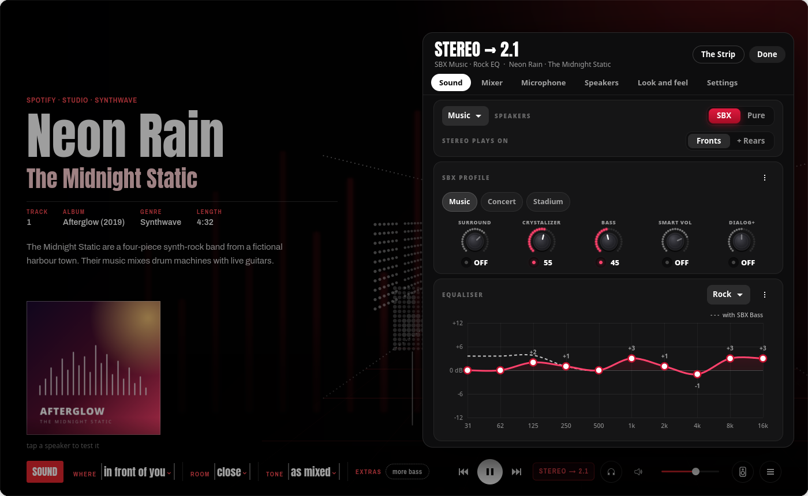

<div align="center">


# Sound Blaster Command for Linux

**A native control panel for the Creative Sound Blaster ZxR on Linux.**<br>
Creative's SBX effects and profiles, the equaliser, speaker setup and microphone effects, plus fixes for the card's Linux driver.

[](LICENSE)


</div>

Creative only makes Sound Blaster Command for Windows. On Linux the ZxR works, but its DSP, equaliser,
speaker setup and microphone effects are hidden behind dozens of raw ALSA controls, and a few of the
defaults are actively bad (more on that [below](#what-it-fixes-on-linux)). This app puts all of it in
one window and works around those defaults.

> **Not affiliated with Creative Technology.** "Sound Blaster", "SBX", "CrystalVoice", "Crystalizer" and
> "Scout Mode" are Creative's trademarks; they're used here only to name the features of their hardware.

---

## Contents

- [Highlights](#highlights)
- [Tour](#tour)
- [What it fixes on Linux](#what-it-fixes-on-linux)
- [Supported cards and systems](#supported-cards-and-systems)
- [Install](#install)
- [Using it](#using-it)
- [Privacy and safety](#privacy-and-safety)
- [How it works](#how-it-works)
- [Development](#development)
- [License](#license)

## Highlights

- **What's playing fills the window.** The title, the artist or studio, credits and a short bio, the cover,
  and behind it all the artist's photos printed in red, a game's official art, or a film's stills.
- **A room that follows what's playing**, seen over your shoulder: a studio with the artist's neon sign and a
  shelf of their other albums for a studio song; a concert hall or a stadium for a live recording; a cinema
  for a film; a gaming room with a monitor for a game; a scoreboard on the big screen for a match. Each speaker
  lights up and pulses with its live level.
  Tap one to hear a test sound on it.
- **The game monitor:** the game's logo, then its trailer once, muted, then its pictures every 10 seconds.
  Point at it for buttons; full screen shows the pictures large, with *Play the trailer · with sound*.
  Films and series get the same screen with their stills; a trailer there only plays when you ask.
- **Four sound choices in plain words** along the bottom: where the sound plays (in front of you, all
  around you), the room (close like the studio, like a live show, untouched), the tone (warmer, as mixed,
  brighter) and extras (clearer voices, more bass, footsteps sooner in games). Each one sets the real
  SBX profile, effects and equaliser.
- **Look and feel:** five themes (Over your shoulder, Blueprint, Screenprint, Callouts, and Compact) and seven
  layouts for the sound choices and the cover. Pick one for every page or save it as the default for music,
  films, TV, games, sport or video.
- **No title bar:** the page fills the window. **☰** at the bottom right opens the **control centre**: one panel
  above the dock with what plays and how (the readout, SBX, the EQ, the song) and tabs for Sound, Mixer,
  Microphone, Speakers, Look and feel and Settings. It keeps one size whatever you press, and every tab
  fits in it without scrolling, in a small window too. The window buttons appear at the top right when you point there; drag the page to move the window.
- **Three compact views:** small windows (under 900 × 600) show the **Remote** or **Over your shoulder, mini**
  (your pick in Look and feel). The mini is the main page made tall: the photo printed in red, the artist's neon
  sign (or an LED wall of dots for films and games, a scoreboard for a match), the six dot speakers round you,
  and the four choices as rows. The **Remote** is a tall card with the artist
  photo printed in red (or the album art, an option), the readout, the room with your speakers, the four
  choices as tiles and the controls. **The Strip** (in ☰) is one 76-pixel row for the edge of a screen or a
  second screen left on all day: the cover, the title, the six speakers with their meters, the four choices,
  the controls with the readout (as on the page), a pin that keeps it above other windows on every desktop
  (KDE), and its own minimise and close buttons, apart from the rest.
- Creative's SBX effects: Surround, Crystalizer, Bass, Smart Volume and Dialog+, each with an on/off switch and a
  level knob, in the **Sound** panel with the equaliser.
- Creative's SBX profiles with their exact values from Creative's Sound Blaster Command for Windows (Gaming,
  Cinema, Concert, Night, FPS, Racing, RPG, Strategy, Stadium, Adventure), separate speaker and headphone values
  where Creative has them, plus this app's own Music profile for studio albums. You can add your own and import
  or export them.
- Creative's 14 game-specific profiles (Counter-Strike, Fortnite, Overwatch, Apex Legends and more), picked by
  themselves when that game runs.
- A 10-band equaliser you adjust by dragging, with Creative's presets from Sound Blaster Command and the Linux
  driver's older Rock as "Rock (classic)".
- The path the sound takes, one click away: the app's format, any resampling or downmixing by PipeWire, the
  card's processing, and the speakers it reaches.
- SBX or Pure mode (Pure turns off the SBX effects; your equaliser stays on).
- Each source plays on the speakers it was made for, by itself: a stereo song on the fronts and subwoofer,
  a 5.1 film, game or track on all six. Stereo can also play on the rears.
- Each kind of content keeps its own sound (music, films, TV, games, sport, online video, streams): its SBX
  profile, EQ, tone and where stereo plays, picked automatically when it starts if you want. Settings are
  also remembered per game and app, and the Music EQ can follow each song's genre.
- Several apps at once: a game keeps the card while music plays in the background, and the music keeps its
  own EQ, tone and speakers (an EQ inside its stream; the card's SBX effects are made lighter while both play).
- A tray icon for the common switches, so you don't need to open the window.
- CrystalVoice microphone effects, a mixer with meters, speaker boost, speaker setup and headphone gain.

## Tour

<table>
<tr>
<td width="50%"><br>
<b>Movie & TV.</b> A 5.1 film from Jellyfin: a ticket across the top (<i>Admit one</i>, the screen, the
sound and the speakers it plays on), the cinema screen showing the title and then the film's stills, and
every speaker lit.</td>
<td width="50%"><br>
<b>Game.</b> The game's art comes from Steam's own files (and the store, or your Playnite library). The
monitor shows the logo, the trailer once (muted), then the pictures. <i>Footsteps</i> (Scout Mode) is a
game-only extra.</td>
</tr>
<tr>
<td><br>
<b>Music.</b> A studio song plays in the artist's studio: their name in neon, their other albums on the
shelf. A stereo song uses the front speakers and subwoofer; the rest wait.</td>
<td><br>
<b>Pure.</b> Room set to <i>untouched</i>: the SBX effects are off. The equaliser stays on, as in Creative's
own app, where SBX and the equaliser are separate switches.</td>
</tr>
<tr>
<td><br>
<b>All around you, Rows layout.</b> A stereo song also plays on the rear speakers. Here the sound choices
sit in rows beside the cover, one of the seven layouts.</td>
<td><br>
<b>Signal path.</b> Click the readout at the bottom right (<code>5.1</code>, <code>STEREO → 2.1</code>):
each step the sound takes. Here the rears get a copy of the fronts, 3 dB quieter.</td>
</tr>
<tr>
<td><br>
<b>Blueprint.</b> The room as a plan from above: angles, the listening zone, the subwoofer on the floor.</td>
<td><br>
<b>Screenprint.</b> A printed room with solid speakers; the game's monitor hangs on the wall.</td>
</tr>
<tr>
<td><br>
<b>Callouts.</b> An isometric drawing with every speaker labelled; the cinema screen sits on the far wall.</td>
<td><br>
<b>Look and feel.</b> The theme, the layout, and the default for each kind of page, with
<i>Back to the default view</i> and <i>Reset to the original defaults</i>.</td>
</tr>
<tr>
<td><br>
<b>The Remote.</b> Small windows show it by themselves: the artist photo printed in red, the cover by the
title, the readout, your speakers with their meters, and the four choices as tiles; each opens its options
in a sheet from the bottom.</td>
<td><br>
<b>The Remote, album art.</b> The option in Look and feel: the album art whole and in colour at the top.</td>
</tr>
<tr>
<td><br>
<b>Over your shoulder, mini.</b> The main page made tall: the artist's neon sign, the six dot speakers round you,
the four choices as rows.</td>
<td><br>
<b>Over your shoulder, mini, a film.</b> An LED wall of dots shows the title's logo, then its stills.</td>
</tr>
<tr>
<td colspan="2"><br>
<b>The Strip.</b> One 76-pixel row for the edge of a screen: the cover and title, the six speakers with their
meters (tap one to test it), the four choices, the controls with the readout, a pin to keep it above other
windows, and the window's own buttons in a group of their own.</td>
</tr>
<tr>
<td><br>
<b>Sound.</b> Speakers or headphones, SBX or Pure, the SBX profile and its five effect knobs, and the
equaliser you drag.</td>
<td><br>
<b>Mixer.</b> A fader and live LED meter per speaker, <b>Speaker boost</b> (0 to +9 dB, like Windows), and
the microphone and What U Hear recording levels.</td>
</tr>
<tr>
<td><br>
<b>CrystalVoice.</b> Noise Reduction, Smart Volume, Focus (how wide the mic listens), VoiceFX, mic boost,
What U Hear and a record-and-play-back test.</td>
<td><br>
<b>Speaker setup.</b> 2.0 to 5.1, your speakers' brand and model (Cambridge SoundWorks DTT2200, or the size of other speakers), full-range
fronts/rears, bass redirection and crossover, headphone gain, and a test sound for every speaker.</td>
</tr>
<tr>
<td><br>
<b>Settings.</b> What to do when something starts playing, per-game memory, the page's pictures and
details (online lookups, an optional TMDB key, your Playnite folder), the tray icon, and fixes.</td>
<td><br>
<b>Signal path, 5.1 film.</b> 48 kHz 5.1 straight through, no resampling, each channel to its own speaker.</td>
</tr>
</table>

## What it fixes on Linux

These are real problems with the ZxR on a stock Linux system, found while building this:

| Problem | What this app does |
|---|---|
| **Fuzzy, distorted sound at high volume.** The driver puts the card's Front/Surround/Centre/LFE sliders at +9 dB and PipeWire drives them as hardware volume, so the card clips. | Pins the card's own sliders at 0 dB and lets PipeWire do volume in software (WirePlumber `api.alsa.soft-mixer`). **Speaker boost** lets you deliberately go up to +9 dB again if you want Windows-level loudness. |
| **5.1 speakers in the wrong places.** The ZxR's DSP expects Windows channel order. | Sets the 5.1 output to `FL,FR,FC,LFE,RL,RR`, so every channel reaches the right speaker. |
| **SBX Bass does nothing on 5.1 or 2.1.** In `ca0132_effects_set` the driver forces X-Bass off whenever the speakers have a subwoofer. | Applies the Bass knob through the card's own equaliser instead (up to +8 dB below the Bass crossover), and bass redirection sends it to the subwoofer. The EQ graph shows it as a dashed line. |
| **Spotify (Flatpak) never reaches the other speakers.** Its stream is labelled `aux0,aux1`, which PipeWire won't place. | Re-labels such streams so they play on the front speakers like any stereo source. |
| **Centre, sub or rear right silent after a boot, sleep or reset.** The card's sound processor sometimes misses the start-up state of those outputs, and the driver never sends it again. Only a lucky restart brought them back. | Switches those outputs off and on again a couple of seconds after the card starts, so the processor picks them up (all six channels in 8 of 8 test restarts). The [driver patch](driver/README.md) does the same inside the driver. |
| **Subwoofer crossover wrong.** The driver replaces the bass redirection crossover with the X-Bass one whenever it redoes the speaker setup, so the sub got less bass than set. | Re-sends the crossover after every change. The driver patch fixes the bug itself, and two smaller ones in the same code. |
| **Settings lost after sleep or a card reset.** The driver resets the card to defaults (2.0, every effect on). | A small background service puts your settings back whenever the card comes back. Optional root helpers add a password-free **Reset the sound card** button. |
| **Effects and EQ are a wall of ALSA controls.** | Creative's profiles and presets with their exact values, read from Creative's own Sound Blaster Command data files. |

## Supported cards and systems

| Sound card | Status |
|---|---|
| **Sound Blaster ZxR** (Sound Core3D / CA0132, PCI `1102:0012`, main codec subsystem `1102:0033`, with the DBpro daughterboard) | **Supported and tested**: every feature, 2.0 to 5.1 speakers and headphones. Developed with Cambridge SoundWorks DTT2200 5.1 speakers. |
| Sound Blaster Z / Zx, AE-5, AE-5 Plus, AE-7, Recon3D (other PCIe CA0132 cards) | **Untested.** The app finds them and skips controls a card doesn't have, so the basics may work; ZxR-only parts (DBpro input, 600 Ω headphone gain) won't. Reports are welcome. |
| Recon3Di motherboard audio, USB Sound Blasters (G3, G6, X3, X4 ...) | **Not supported.** |

| System | Status |
|---|---|
| **Linux** with PipeWire, WirePlumber and pipewire-pulse, GTK 4.14+ and libadwaita 1.6+ | **Supported.** Developed and tested on CachyOS (Arch-based), Linux 7.3, KDE Plasma 6 on Wayland. Current Arch, Fedora 41+, Ubuntu 24.10+ and Debian 13+ have the right library versions but are untested. Works on GNOME too; the tray icon needs StatusNotifierItem support (the AppIndicator extension on GNOME). |
| Linux with PulseAudio only, or Ubuntu 24.04 and older (libadwaita 1.5) | **Not supported.** The app configures PipeWire and WirePlumber. |
| Windows, macOS | **No.** On Windows, use Creative's own Sound Blaster Command. |
| **Optional driver patch** ([`driver/`](driver/README.md)) | Linux **6.17 or newer** (the driver moved to `sound/hda/codecs/` in 6.17), tested on 7.3. Needs your kernel's headers. The module is unsigned, so it won't load where Secure Boot enforces module signatures. You don't need it: the app works around the same problems on the stock driver. |

## Install

### Requirements

- Linux with **PipeWire**, **WirePlumber** and **pipewire-pulse** (for `pactl` and `parec`)
- **GTK 4.14+** and **libadwaita 1.6+**
- **Rust** (edition 2024, so 1.85 or newer) to build
- systemd (user services, `busctl`), `curl`; optional: `notify-send`, a StatusNotifierItem tray (KDE Plasma, or the AppIndicator extension on GNOME)
- Optional, for game trailers: `ffmpeg` (saves Steam's trailer streams once) and the GStreamer plugins GTK plays
  video with (`gst-plugins-good`, `gst-libav`). Without them the pictures still show.
- A **Creative Sound Blaster ZxR**; see [Supported cards and systems](#supported-cards-and-systems)

On Arch / CachyOS:

```sh
sudo pacman -S --needed rust gtk4 libadwaita alsa-lib pipewire pipewire-pulse wireplumber curl libnotify ffmpeg gst-plugins-good gst-libav
```

### Build and install (no sudo)

```sh
git clone https://github.com/ImZoomBoy/soundblaster-command-linux.git
cd soundblaster-command-linux
./install.sh
```

This builds the app, installs it to `~/.local/bin/sbcommand` with a menu entry and icon, and starts the
`sbcommand-watch` user service, which keeps your settings on the card and runs the tray icon.
The first run writes small PipeWire/WirePlumber config files, so sound may stop for a second once while they load.

Optional, with sudo: the password-free **Reset the sound card** button (and a sleep hook that is off by default).

```sh
sudo packaging/root/install-root-helpers.sh
```

If sound or video stalls after waking from sleep, also run `sudo bash packaging/root/boot-and-sleep-fix.sh`
and restart. It adds `iommu=pt` to the kernel command line, which stopped the card's IOMMU errors after sleep.
It does this automatically on Limine (CachyOS's default boot loader) and prints the steps for GRUB and
systemd-boot.

To remove it: `./install.sh --uninstall` (your settings in `~/.config/sbcommand` are kept).

Optional, the [driver patch](driver/README.md): `sh driver/build.sh` (downloads and builds the matching driver
source, no sudo), then `sudo sh driver/install.sh`. Sound stops for a few seconds while the card reloads.

## Using it

Open **Sound Blaster Command** from your app menu, or:

```sh
sbcommand                # the window
sbcommand mixer          # open straight to a panel: sound, look, mixer, crystalvoice, setup, settings
sbcommand apply          # send the saved settings to the card (what the service does at login)
sbcommand detect         # read-only: what's playing and what the app would pick
sbcommand selftest       # drive every control in a dry run (no card, temporary settings)
```

Tips:

- **Knobs turn:** drag round them clockwise or anticlockwise, scroll, or focus one and use the arrow keys.
  Turning a knob switches its effect on; the small LED above it switches it off.
- **Tap a speaker** in the room to hear a test sound on it.
- **The four choices at the bottom** each open a short list in plain words; the small print under each says
  what it sets (the SBX profile, an effect, the equaliser).
- **Point at the game monitor** for its buttons: previous and next picture, play or stop the trailer, its
  sound, full screen. In full screen the pictures change every 10 seconds; the arrow keys move between them,
  and Esc goes back. A trailer that's playing keeps playing between the two.
- **Click the readout** at the bottom right to see each step the sound takes.
- **☰ at the bottom right** opens the control centre on the tab you used last; **Done**, Esc or a click
  outside closes it. Its **The Strip** button switches to the thin row.
- **Look and feel** (in ☰) picks the theme, the layout, which compact view small windows show, the Remote's top
  picture and the Strip's pin.
- **The window buttons** fade in at the top right when you point there; drag any empty part of the page to
  move the window.
- **Speakers ↔ headphones always asks first**, so you never switch by accident.
- When a game or app plays again, your last **profile and EQ for it come back**, with an Undo.

## Privacy and safety

- **No AI, no telemetry, no accounts.** Everything runs locally.
- For the page's pictures and details, only names (the artist, the album, the game, the film) and Steam's game
  number are sent. Everything fetched is kept under `~/.cache/sbcommand`, so each one is asked about once
  (renewed after 30 days):
  - **MusicBrainz**: the artist's genre, to match the Music EQ (can be switched off), and the artist's other
    albums for the record shelf, with covers from the **Cover Art Archive**;
  - **TheAudioDB**: artist photos, logo and a short bio;
  - **Steam**: a game's art from Steam's own files first, then its store page (screenshots, trailer). Trailers are
    saved once with `ffmpeg` (the newest 12 are kept) and play **muted** on the monitor; sound only in full
    screen or when you turn it on;
  - **TMDB**: film and series pictures, only if you enter your own free API key;
  - your **Playnite** library folder, if you set one (read from disk, no network);
  - the **cover art** the player itself reports.
- **Settings → Pictures and details → Look up pictures and details online** switches the page's lookups off;
  it then uses the player's own cover art. The genre lookup has its own switch.
- The **level meters** only *read* the card's output monitor while the window is open. Nothing is recorded or played.
- The app never restarts PipeWire, pipewire-pulse or WirePlumber during normal use (that would cut sound
  in your browser). It only writes their config files when a setting really needs it.
- Card controls are written directly through ALSA; anything slow runs on a background thread, so the window
  never freezes.

## How it works

| Module | Does |
|---|---|
| `model.rs` | Settings, Creative's SBX profiles and EQ presets (exact values from Sound Blaster Command 3.4.98), game profiles, the ALSA control values for each setting, Pure, Speaker boost, per-app memory |
| `card.rs` | Writes the card's ALSA controls and hardware levels |
| `system.rs` | PipeWire / WirePlumber: 5.1 channel order, soft-mixer, extra outputs (2.1, stereo), stream re-labelling, stereo on the rears (per-stream upmix), volume |
| `worker.rs` | Background thread for all card and audio work; the `watch` service; what's-playing detection |
| `detect.rs` | Tells Game / Movie & TV / Music from the playing streams, MPRIS players and Steam/Proton/Wine processes |
| `media.rs` | Now playing: MPRIS metadata, stream format from PipeWire, Steam game names and artwork |
| `genre.rs` | Song genre → Creative EQ preset (rules, no AI), with MusicBrainz lookups |
| `meters.rs` | Live per-speaker levels from the card's monitor (`parec`) |
| `meta.rs` | What kind of thing is playing (studio song, live recording, film, series, game, match, web video) and its pictures and details: TheAudioDB, Steam, MusicBrainz and the Cover Art Archive, TMDB, Playnite; cached |
| `art.rs` | Picture processing: the page-red print, auto levels for dark game art, darkening |
| `stage.rs` | The page's layers: background pictures, the room, the title block, the corner, the cover, the sound choices (slim dock, rows, bar), the controls, the monitor video; sizes for smaller windows |
| `ui/page.rs` | The page's behaviour: what's playing → title, credits, corner and choices; the monitor and full screen; Look and feel |
| `oys.rs` | The Over your shoulder room (cairo) |
| `themes.rs` | The Blueprint, Screenprint and Callouts rooms (cairo) |
| `fonts.rs` | The bundled Anton, Archivo Narrow and Archivo fonts, for this app only |
| `mini.rs` | The compact views: the Remote and Over your shoulder, mini (small windows; the mini's neon, LED wall and dot speakers), the Strip (one thin row) and its pin (a KWin script) |
| `room.rs`, `dash.rs` | The speakers as real cabinets with LED meters (the Remote's room, the Strip's row), knobs, the EQ curve and signal-path dots (cairo) |
| `ui.rs` | The GTK 4 / libadwaita window and its side panels |
| `tray.rs` | The tray icon (StatusNotifierItem via `ksni`) |
| `selftest.rs` | `sbcommand selftest`: clicks through every control and checks the settings follow |

## Development

```sh
cargo test               # unit tests (model, detection, genres, media)
cargo build --release
./target/release/sbcommand selftest   # dry run: never touches the card or your settings
```

`SBCOMMAND_DRYRUN=1` prints card writes instead of making them; `SBCOMMAND_CONFIG_DIR` points settings
elsewhere. A dry run looks nothing up online; `SBCOMMAND_META_LIVE=1` allows the picture lookups anyway (and a
muted trailer), with `SBCOMMAND_DEMO_TITLE`, `SBCOMMAND_DEMO_ARTIST`, `SBCOMMAND_DEMO_ALBUM` and
`SBCOMMAND_DEMO_NOART=1` to fake what's playing. `SBCOMMAND_TMDB_KEY` is another way to give a TMDB key.
Screenshots like the ones above come from the app itself (`SBCOMMAND_SHOT_DELAY` in ms,
`SBCOMMAND_SHOT_FULL=pictures|trailer` for the full-screen view):

```sh
SBCOMMAND_DRYRUN=1 SBCOMMAND_CONFIG_DIR=/tmp/sbc SBCOMMAND_DEMO_MEDIA=music \
SBCOMMAND_DEMO_ART=assets/demo/music.png SBCOMMAND_SHOT_SIZE=1280x820 \
SBCOMMAND_SHOT=shot.png ./target/release/sbcommand
```

Helper scripts in `dev/`:

| Script | Does |
|---|---|
| `dev/isolated-kwin.sh "<cmd>"` | Runs a GUI command in a private virtual KWin, apart from your desktop (use it for `selftest`) |
| `dev/screenshots.sh` | Retakes every screenshot in `docs/screenshots` |
| `dev/where-is-each-channel.sh` | Silent check that each of the six channels lands where it should in PipeWire |
| `sudo sh dev/pin-sense.sh` | Read-only: which output sockets the card detects a plug in, and how each output is set up |

[`capture/`](capture/README.md) holds the tools that found the silent-channel bug:
- `capture/dsp-probe.sh` records each output of the card's sound processor and shows which channel reaches it,
  without listening. It needs the test driver (`sh driver/build.sh --dev`).
- The scripts that captured Creative's Windows driver starting the card, in a virtual machine.

The demo tracks, film and game (*Neon Rain*, *Starfall*, *Night Circuit*) and their artwork are made up for these screenshots.

Contributions are welcome, especially tests on other CA0132 cards (Sound Blaster Z, ZxR variants, Recon3D, AE-5).

## License

[GPL-3.0-or-later](LICENSE). Copyright © 2026 the Sound Blaster Command for Linux contributors.
The bundled Anton, Archivo Narrow and Archivo fonts in [`assets/fonts`](assets/fonts) are under the SIL Open Font License 1.1.
